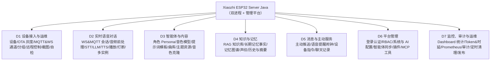
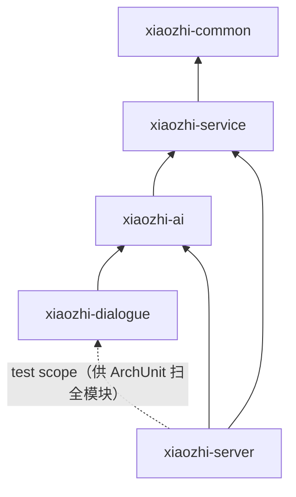
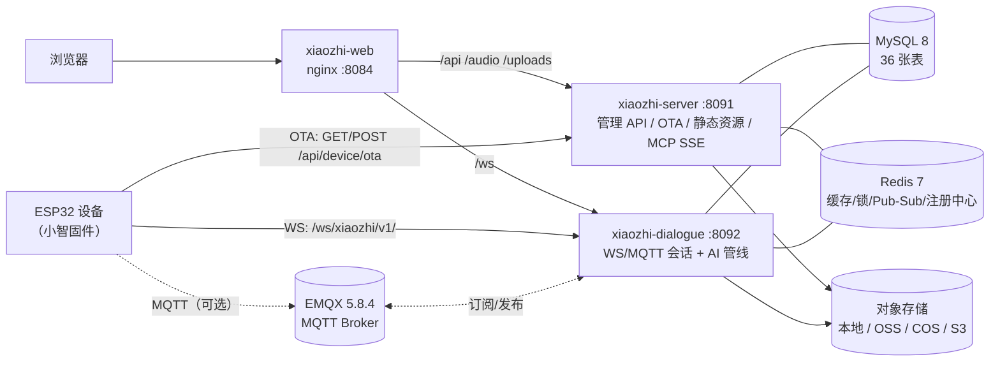
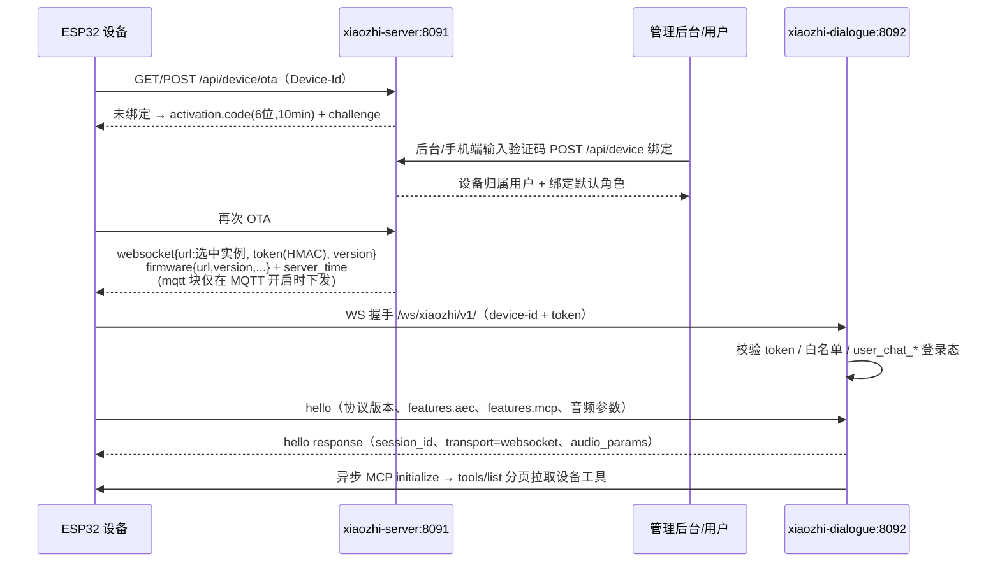
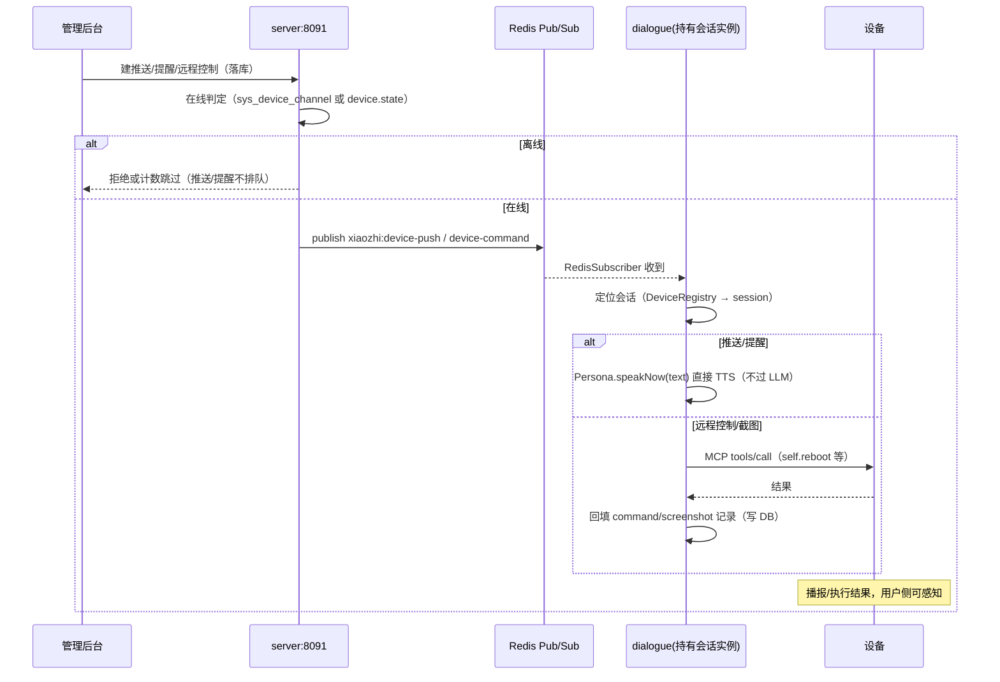

# 功能模块梳理（Xiaozhi ESP32 Server Java）

> 文档目的：把当前仓库**实际实现**的功能模块、代码边界、数据资产与端到端链路梳理清楚，供接手开发、方案评审、排期拆解与发布核对使用。
>
> 盘点口径：基于当前工作区 `main` 分支静态代码（2026-11-03），逐文件阅读 + 交叉核对；功能梳理本身不依赖运行中的服务，但对 2026-11-03 的增量改动（操作日志、提醒锁、配置透传、前端页面）执行了真实的编译、单测、架构守卫与前端 type-check/test 验证。数字一律以代码/建表脚本实测为准，与旧文档冲突处在 §9.4 单独列出。
>
> 原始盘点稿（含更细的行号级证据）：`.analysis/backend-admin.md`、`.analysis/voice-ai.md`、`.analysis/frontend-infra.md`。
>
> 项目版本：根 `pom.xml` 为 `6.1.0`，`CHANGELOG.md` 已列出未发布的 `6.2.0` 功能批次（OTA/固件、MQTT、推送、提醒、知识库、记忆、声纹、监控等，见 §9.4 版本口径）。
>
> 增量（2026-11-03）：操作日志查询、提醒扫描分布式锁、部署配置透传已落地（见 §9.7）；
> 未完成缺口的文件级改动清单、验收与排期见 [GAP-FIX-PLAN.md](./GAP-FIX-PLAN.md)。

---

## 0. 三分钟速览

### 0.1 项目是什么

为 **ESP32 语音硬件（小智固件）** 提供后端服务 + 可视化管理平台的 **Java 企业级实现**。上游是开源项目 `joey-zhou/xiaozhi-esp32-server-java`，本仓库在其基础上补齐了 `docs/PLATFORM-ROADMAP.md` 中的商业版能力（OTA 灰度、MQTT 通道、主动推送、语音提醒、远程控制/截图、RAG 知识库、长期记忆与图谱、声纹、音乐曲库、监控面板等）。

一句话：**设备侧只负责"听/说/联网"，服务端负责"接入鉴权、OTA、语音链路编排、大模型与工具、设备管理后台"**。

### 0.2 核心数字（实测）

| 维度 | 数值 | 说明 |
|---|---|---|
| Maven 模块 | **5** | common / service / ai / dialogue / server |
| 运行进程 | **2 + 1** | server:8091、dialogue:8092 两个 Spring Boot 进程 + web:8084 静态站点 |
| 主代码 Java 文件 | **704** | server 65 / service 217 / ai 126 / dialogue 84 / common 212 |
| REST 控制器 / 端点 | **29 + 1 / 124** | server 侧 29 个 `@RestController`、123 个 HTTP 入口；dialogue 另有多模态入口 `POST /api/vl/chat` |
| 数据表 | **36** | `db/init.sql` 36 张 `sys_*` 表，与 36 个 `@TableName` 实体一一对应 |
| 权限种子 / 接口权限点 | **115 / 111** | `sys_permission` 行数（24 菜单 + 1 按钮 + 90 接口）/ `@SaCheckPermission` 处数 |
| AI Provider | **9 LLM + 8 STT + 8 TTS** | 详见 §4 |
| 前端页面 | **33 个视图 / 28 条业务路由** | Vue3 管理端，7 个侧边栏菜单组 |
| 测试 | **240 个 Java 测试类 + 70 个前端测试文件（558 条用例）+ 2 个 e2e** | 含 12 个 ArchUnit 架构守卫（58 条）+ 2 个守卫型测试 |
| 功能域 | **7 大域 / 40 个子模块** | 见 §2 |

### 0.3 能力全景图



### 0.4 阅读指引

- 想知道"系统由哪些进程/模块组成" → §1
- 想知道"有哪些功能、各自在哪个域" → §2（主章节）
- 想知道"一轮对话/一次 OTA 到底怎么走" → §3
- 想知道"支持哪些大模型/语音厂商、工具怎么接" → §4
- 想知道"后台页面与权限怎么对应" → §5
- 想知道"数据怎么存、表怎么分" → §6
- 想知道"鉴权/缓存/广播/多实例/测试怎么兜底" → §7
- 想知道"怎么部署发版、有哪些已知缺口与风险" → §8、§9

---

## 1. 总体架构

### 1.1 代码模块与依赖

```
web (Vue3 管理端, 独立构建, nginx :8084)
  │  /api  → server:8091        /ws → dialogue:8092
  ▼
xiaozhi-server (:8091, 主启动应用)
  │  Controller + AppService + 拦截器/过滤器 + 指标 + MCP Server SSE
  ├─▶ xiaozhi-service (业务核心 + DAL + 缓存 + 审计切面 + 定时任务)
  └─▶ xiaozhi-ai (LLM/STT/TTS Provider 工厂、知识库、记忆、声纹、工具、插件、HomeAssistant)
          ▲
xiaozhi-dialogue (:8092, 对话服务, 可横向扩展)
  └─▶ xiaozhi-ai（传递依赖 common/service）
xiaozhi-common (公共层: 模型/事件/枚举/工具/缓存/注解/端口倒置)
```

| 模块 | 定位（pom 描述） | 规模 | 启动类 / 端口 | 关键内容 |
|---|---|---|---|---|
| `xiaozhi-common` | 公共层：entity、dto、event、enums、utils、common | 212 | 无（被依赖） | `ApiResponse`/`PageResult`、6 个业务异常、14 个领域事件、`RedisBroadcast`（8 频道）、6 个缓存空间、`DateUtils`/`AudioUtils`/`OpusProcessor`、`@AuditLog`/`@CheckOwner`/`@Sensitive`、Sa-Token 权限接口、文件签名策略 |
| `xiaozhi-service` | 服务层：业务核心（设备、固件、智能体、消息、模板）、用户权限、存储、监控、操作日志 | 217 | 无 | 各业务域 `domain/service/dal/convert/support` 四件套、`RedisDialogueServerRegistry`、存储适配（local/OSS/COS/S3）、Ownership 检查器、限流/权限实现、定时清理任务 |
| `xiaozhi-ai` | AI 能力平台：LLM/TTS/STT provider + 记忆管理 | 126 | 无 | `ChatModelFactory`/`SttServiceFactory`/`TtsServiceFactory`、9/8/8 个 Provider、工具注册与召回、设备/服务端 MCP、知识库索引检索、长期记忆/图谱抽取、声纹、插件 SPI、HomeAssistant、配置试拨 |
| `xiaozhi-dialogue` | 对话层：communication + 音频前处理/管道 + 会话管理 + MCP + 工具调用 | 84 | `DialogueApplication` / **8092** | WebSocket/MQTT 接入、二进制 Opus 协议 v1/v2/v3、VAD+AEC3、`DialogueService`、`Persona`、`ScheduledPlayer`（60ms/帧）、打断、落库与摘要、设备 MCP 客户端、9 个系统工具 |
| `xiaozhi-server` | 启动器 + Controller，聚合所有模块 | 65 | `XiaozhiApplication` / **8091** | 29 个 Controller、AppService、Sa-Token/JWT、限流、Ownership、审计切面与查询、文件签名 URL、OSS 配置切换保护、OTA、统计、Prometheus 指标、MCP Server SSE |
| `web` | Vue3 + TS 管理端 | 32 视图 | nginx **8084** | 32 个页面、27 条业务路由、7 个菜单组、权限路由守卫、WS/SSE 客户端 |
| `db` | 建表与升级 | 36 表 + 7 个升级脚本 | — | `init.sql`（新装）+ `upgrade/<日期>__<说明>.sql`（幂等升级） |

依赖方向（架构守卫 `ModuleBoundaryArchTest` 强制）：



要点：
- **server 不依赖 dialogue**（仅测试作用域），因此"管理后台"与"实时对话"可以分别部署、分别扩容、互不阻塞。
- server 不允许直接 import DAL 或第三方 SDK（`ModuleBoundaryArchTest`/`ForbiddenDependencyArchTest`），第三方能力必须经 service/ai 的接口暴露。

### 1.2 运行时拓扑（Docker Compose 形态）



| 组件 | 端口（宿主） | 作用 | 备注 |
|---|---|---|---|
| `web`（nginx） | 8084 | 静态 SPA + 反向代理 `/api`→server、`/ws`→dialogue | `/api` 读超时 300s（知识库解析长任务） |
| `xiaozhi-server` | 8091 | 管理后台 REST、登录权限、OTA、文件访问、Prometheus、MCP Server SSE | 主启动应用 |
| `xiaozhi-dialogue` | 8092 | 设备 WebSocket/MQTT、语音对话管线、TTS/STT、工具执行、指标写入 | 支持横向扩展，实例注册到 Redis |
| `mysql` | 13306（仅回环） | 业务数据 | 首次启动执行 `db/init.sql` |
| `redis` | 不映射 | 缓存、分布式锁、Pub/Sub、实例注册、设备→实例映射 | AOF 持久化 |
| `emqx` | 1883（设备直连）/ 18083（控制台，仅回环） | MQTT 通道 | 可选，`XIAOZHI_MQTT_ENABLED=false` 时设备只走 WS |

### 1.3 双进程的加载范围差异（重要设计）

两个启动类用**手写**的 `@ComponentScan`/`@MapperScan` 白名单，只加载自己需要的包（`ComponentScanCoverageArchTest` 守护，新增包漏加会红）：

| 包域 | server | dialogue | 说明 |
|---|---|---|---|
| `common` / `communication` / `utils` / `ai` | ✅ | ✅ | 两边共享 |
| `role`、`device`、`config`、`message`、`summary`、`music`、`knowledge`、`memoryfact`、`memorygraph`、`voiceprint`、`channel`、`command`、`screenshot`、`devicegroup`、`mcptoolexclude`、`stats`、`monitoring`、`storage`、`task`、`verifycode` | ✅ | ✅ | 对话链路要读角色/设备/知识/记忆/曲库，并写消息、指标、通道状态 |
| `user`、`userauth`、`permission`、`security`、`operationlog`、`template`、`agent`、`authrole`、`push`、`reminder`、`firmware`、`voiceclone` | ✅ | ❌ | 只属于管理后台 |
| `dialogue` | ❌ | ✅ | 实时链路专属 |

> 结论：**dialogue 不提供后台接口**，它只消费/写入共享表；管理动作通过 server 落库 + Redis 广播交给 dialogue 执行（见 §1.4）。

### 1.4 进程间协作：Redis Pub/Sub（8 个频道）

server 拿不到 WebSocket 会话，凡是"让设备真正开口/执行"的动作都走广播（`xiaozhi-common/.../communication/common/RedisBroadcast.java`，事件在 **事务提交后** 发布）：

| 频道 | 触发方 | dialogue 侧动作 |
|---|---|---|
| `xiaozhi:role-updated` | 角色属性（音色/模型/VAD）变更 | 清 Persona、清历史、刷新 VAD 阈值，**下一轮 `ensurePersona` 重建** |
| `xiaozhi:role-changed` | 设备切换角色 | 刷新设备/角色绑定，flush 旧对话，清 Persona |
| `xiaozhi:config-changed` | AI 配置（模型/STT/TTS/Token）变更 | 清各工厂缓存，按 modelId 清 Persona |
| `xiaozhi:clear-conversation` | 后台清空对话历史 | 清空会话上下文 |
| `xiaozhi:close-session` | 强制关会话/清理"幽灵会话" | 关闭本实例对应会话（可排除 sessionId） |
| `xiaozhi:device-updated` | 设备信息变更 | 刷新会话内的设备对象 |
| `xiaozhi:device-push` | 主动推送 / 提醒播报 | `Persona.speakNow(text)` 直接 TTS 播报，**不过 LLM** |
| `xiaozhi:device-command` | 远程控制 / 截图 | `DeviceMcpService.callDeviceTool` 调设备工具并回填记录 |

另外两个跨进程注册表：
- **dialogue 实例注册**：`RedisDialogueServerRegistry` 用 Redis Hash + 心跳 key（TTL 60s），server 在 OTA 响应里下发"随机选中实例"的 WS 地址。
- **设备→实例映射**：`DeviceRegistry`（`xiaozhi:device:instance:{deviceId}`，TTL 300s），用于把指令投递到持有会话的实例。

### 1.5 存储与外部依赖

| 类别 | 实现 | 说明 |
|---|---|---|
| 关系库 | MySQL 8（MyBatis-Plus，36 表，无 Flyway） | 建表/种子统一 `db/init.sql`；结构变更同时改 init + `db/upgrade/*.sql` |
| 缓存/锁/广播 | Redis 7（Lettuce 连接池 + Redisson 仅用于分布式锁） | 权限按角色缓存 7 天、角色/设备/用户配置缓存 1 天 |
| 对象存储 | 本地磁盘 / 阿里 OSS / 腾讯 COS / S3（MinIO 等） | `sys_config` 中默认 oss 配置决定当前实现；支持签名 URL |
| 设备通道 | WebSocket（默认）/ MQTT（EMQX，可选） | MQTT 开关决定 OTA 响应是否下发 `mqtt` 块（固件不支持时必须关） |
| 本地模型 | sherpa-onnx（SenseVoice/VITS/Matcha）、Vosk、Silero VAD、speaker embedding | 镜像内预置或 `./xiaozhi.sh download` 下载；`models/`、`lib/` 不入库 |
| 外部 AI | 大模型/语音厂商 API、DeepSeek 联网搜索、Home Assistant | 全部在后台配置，系统不预置任何密钥 |

---

## 2. 功能模块全景

### 2.0 全景总表（7 大域 / 40 个子模块）

| 域 | 子域 | 一句话 | 主要页面 | 状态 |
|---|---|---|---|---|
| **D1 设备接入与运维** | 设备管理 | 设备档案、验证码/扫码绑定、批量改角色、级联删除 | `/device` | ✅ |
| | OTA 与固件灰度 | 固件库、升级任务（全量/比例/白名单 + 时间窗）、升级记录 | `/firmware` | ✅ |
| | 通道管理 | WS 在线状态 + MQTT 通道登记与巡检 | 设备列表回显 | ✅ |
| | 设备分组 | 按空间分组，支撑多设备就近应答 | `/device-group` | ✅ |
| | 远程控制 / 截图 | 动作翻译成设备 MCP 工具，在线才下发，记录结果 | 设备页弹窗 | ✅ |
| | 接入自检 | 8 项只读体检，逐项给依据与修复建议 | 设备页弹窗 | ✅ |
| **D2 实时语音对话** | 会话接入 | WS 握手鉴权、hello 协商、WS/MQTT 双通道、会话状态机 | —（设备侧） | ✅ |
| | 音频前处理 | Opus 解码、服务端 AEC3、Silero VAD 断句/换流/时长上限 | — | ✅ |
| | 识别（STT） | 8 家 provider、热词、情感、失败整段重放 | — | ✅ |
| | 对话生成 | 9 家大模型、流式、工具调用、知识/记忆注入、安抚词 | — | ✅ |
| | 合成与播放（TTS） | 8 家 provider、分句、60ms 精确节拍、静音续播 | — | ✅ |
| | 打断（barge-in） | 首字预暂停 → 终稿裁决 → 取消合成 → 截断历史 | — | ✅ |
| | Web 聊天 | 浏览器 SSE 流式聊天、会话管理、悬浮聊天 | `/chat`、悬浮窗 | ✅ |
| | 多设备就近应答 | 同组多设备同时唤醒仅一台应答（默认关） | — | 🟡 默认关 |
| **D3 智能体与内容** | 角色（Persona） | 模型/音色/STT/VAD/温度/默认角色/空闲超时 | `/role` | ✅ |
| | 提示词模板 | 模板 CRUD，注册时自动复制默认模板 | `/template`（隐藏菜单） | ✅ |
| | 曲库与音乐播放 | 曲库管理、点播统计、目录同步、设备点播工具 | `/music` | ✅ |
| | 主题资源 | 按角色生成唤醒词/表情/配色 JSON | `/theme-resource` | ✅ |
| | 音色克隆 | 记录/状态机/页面就绪，**未接真实服务商** | `/voice-clone` | 🟡 |
| **D4 知识与记忆** | 知识库 RAG | 文档解析→切片→向量化→按角色检索注入 | `/knowledge` | ✅ |
| | 长期记忆 | 人工录入/自动提炼，按说话人注入提示词 | `/memory-fact` | ✅ |
| | 记忆图谱 | 事实抽三元组，关系随记忆注入 | `/memory-graph` | ✅ |
| | 声纹识别 | 成员注册/比对，识别结果注入说话人 | `/voiceprint` | ✅ |
| | 历史与摘要 | 消息历史、上下文窗口裁剪、LLM 摘要压缩 | `/memory/chat` | ✅ |
| **D5 消息与主动服务** | 主动推送 | 按设备/用户选择目标，只投在线设备，TTS 播报 | `/push` | ✅ |
| | 语音提醒/闹钟 | 一次性/每天/工作日，30s 扫描，离线顺延/记错过 | `/reminder` | ✅ |
| | 聊天记录管理 | 消息分页、单条/按设备清空、摘要删除 | `/memory/chat` | ✅ |
| **D6 平台管理** | 用户与认证 | 账号密码/短信/微信登录、注册、找回、启停 | `/login`、`/user` | ✅ |
| | RBAC | 权限角色-权限树、按角色缓存、接口级权限键 | `/auth-role` | ✅ |
| | 系统与 AI 配置 | LLM/STT/TTS/OSS 配置、默认唯一、真实试拨 | `/config/*` | ✅ |
| | 智能体平台同步 | 拉取 Coze/Dify/讯飞智能体列表并落配置（列表只读，平台配置可改） | `/config/agent` | 🟡 列表只读 |
| | 插件 | SPI 发现 + 启停（内存态） | `/plugin` | 🟡 无持久化 |
| | MCP 工具管理 | 按角色/全局排除工具、查询工具清单 | 角色/配置页内嵌 | ✅ |
| | 文件与存储 | 上传（类型/扩展名/MIME/大小校验）、存储切换保护 | 组件级 | ✅ |
| **D7 监控与运维** | 监控面板 | 设备在线、消息量、Token、时延、活跃 Top | `/dashboard` | ✅ |
| | 对话指标 | 每轮落 token/耗时/TTS 首块耗时 | Dashboard 内 | ✅ |
| | 运维端点 | `/actuator/health`、`/actuator/prometheus` + Ops Token 闸门 | — | ✅ |
| | 操作审计 | 67 处 `@AuditLog` 异步落库、180 天清理、分页查询（模块/操作/用户/结果/时间范围） | `/operation-log` | ✅ |
| | 定时清理 | 录音/消息音频/验证码/审计日志/空闲会话/提醒扫描 | — | ✅ |
| | 发布运维 | Docker Compose、`deploy.sh` 发版/回滚、CI 三流水线 | — | ✅ |

> 状态图例：✅ 完整实现并有页面/接口；🟡 部分实现或有明确边界（见 §9.2）；⬜ 未交付。

### 2.1 D1 设备接入与运维

| 子功能 | 职责与关键规则 | 关键实现 | 数据表 | 入口 |
|---|---|---|---|---|
| 设备管理 | 设备以 MAC 为主键；两种绑定：① 验证码绑定（`sys_code` 有效码 → 用户默认/首个角色 → 建设备）② 扫码绑定（要求 10 分钟内存在有效码，防静态二维码抢绑）；删除设备级联作废验证码、逻辑删消息、删摘要；批量改绑角色 | `DeviceController`、`DeviceAppService`、`DeviceServiceImpl`、`DeviceRepositoryImpl` | `sys_device`、`sys_code` | `GET/POST /api/device`、`PUT/DELETE /api/device/{id}`、`POST /api/device/batchUpdate`、`/scan-bind`；页面 `/device`（`system:device`） |
| OTA 检查（匿名） | 设备 `GET/POST /api/device/ota`：未绑定下发 6 位激活码（10 分钟有效、可复用、摇号防重）+ 校验挑战；已绑定下发 WS 地址/token/协议版本/server_time/固件信息，可选 `mqtt` 块；IP 归属只采信可信代理 | `DeviceController.ota`、`DeviceAppService.handleOta`、`OtaMetrics` | `sys_device`、`sys_code`、（升级）`sys_firmware*` | `GET/POST /api/device/ota`、`POST /api/device/ota/activate`；无 UI |
| 固件灰度升级 | 固件版本库 + 升级任务（全量 `all` / 按设备 ID 哈希百分比 `percent` / 白名单 `whitelist`）+ 时间窗；OTA 命中规则：任务进行中 → 时间窗 → 芯片型号匹配 → 目标固件启用且版本更高 → 策略放行 → 取最高版本；下发写升级记录，失败只告警不影响 OTA；任务状态机：待开始/进行中/暂停/结束 | `FirmwareController`、`FirmwareReleaseController`、`FirmwareUpgradeLogController`、`FirmwareReleaseServiceImpl.resolveForDevice` | `sys_firmware`、`sys_firmware_release`、`sys_firmware_upgrade_log` | `GET/POST/PUT/DELETE /api/firmware*`、`/api/firmware/release*`、`POST /release/{id}/state`、`GET /upgrade-log`；页面 `/firmware`（`system:firmware`） |
| 通道管理 | WS 设备只更新 `device.state`；MQTT 设备由 dialogue 的 `MqttBridge` 写 `sys_device_channel`（通道类型/clientId/在线/最近消息）；`MqttPresenceSweeper` 30s 巡检把超 TTL 的置离线 | `MqttBridge`、`MqttPresenceSweeper`、`DeviceChannelServiceImpl` | `sys_device_channel` | server 只读回显，无 REST；OTA 的 `mqtt` 块受 `xiaozhi.mqtt.enabled` 控制 |
| 设备分组 | 分组与成员管理（group+device 唯一），供 `WakeCoordinator` 做"同空间仅一台应答"；默认关闭 | `DeviceGroupController`、`DeviceGroupServiceImpl`、`WakeCoordinator` | `sys_device_group`、`sys_device_group_member` | `/api/device-group`、`/{groupId}/member`；页面 `/device-group`（复用 `system:device`） |
| 远程控制 | 动作 → 设备 MCP 工具（默认 `self.reboot`、`self.audio_speaker.set_volume`，可配），在线判定双通道（channel 表或 `device.state`），离线直接拒绝；落 `sys_device_command` 后广播 `xiaozhi:device-command`，由 dialogue 执行并回填 | `DeviceCommandAppService`、`DeviceCommandServiceImpl`、`RedisBroadcast` | `sys_device_command` | `POST /api/device/{id}/command`、`GET /api/device/command-log`；设备页弹窗 |
| 设备截图 | 复用指令通道调 `self.screen.snapshot`（可配），先写 command 再写 screenshot 记录；回传 http/data-URI 才落库，纯 base64 不落库 | `DeviceScreenshotAppService`、`DeviceScreenshotServiceImpl` | `sys_device_screenshot` | `POST /api/device/{id}/screenshot`、`GET /api/device/screenshot-log`；设备页弹窗 |
| 接入自检 | 8 项只读体检：绑定、在线、设备信息完整度、OTA 地址可达、dialogue 在线实例、MQTT 通道、设备鉴权、可升级固件；每项给 pass/warn/fail + 依据 + 建议；不发任何下行 | `DeviceSelfCheckService` | 读多张表 | `GET /api/device/{id}/self-check`；设备页弹窗 |

### 2.2 D2 实时语音对话与交互

> 端到端细节见 §3.2，Provider 矩阵见 §4。

| 子功能 | 职责与关键规则 | 关键实现 | 主要配置 |
|---|---|---|---|
| 会话接入 | WS 路径 `/ws/xiaozhi/v1/`；握手 `DeviceAuthHandshakeInterceptor`：MAC 设备校验 OTA 签发的 HMAC token，`user_chat_*` 虚拟设备校验 Sa-Token 登录且 deviceId 必须逐字匹配；未配 `XIAOZHI_DEVICE_AUTH_SECRET` 直接放行；白名单设备免 token | `WebSocketConfig`、`WebSocketHandler`、`DeviceAuthHandshakeInterceptor` | `xiaozhi.device-auth.*` |
| 二进制协议 | 上行/下行同源：v1 裸 Opus、v2 带 16B 头（含 timestamp，服务端 AEC 参考对齐）、v3 带 4B 头；帧头不自洽整体降级 v1 | `BinaryProtocolCodec` | `xiaozhi.communication.websocket-protocol-version`（默认 2） |
| 消息类型 | 上行 JSON 7 种：`hello`/`listen`/`iot`/`abort`/`goodbye`/`ping`/`mcp`（+ unknown 兜底）；下行 JSON 6 种：`hello`/`tts`/`stt`/`llm`(emotion)/`iot`/`mcp` + 二进制音频帧 | `communication/domain/*`、`MessageSender` | — |
| 状态机 | `IDLE → LISTENING → THINKING → SPEAKING → LISTENING`；设备 `listen/start\|stop\|detect` 驱动 manual 模式，服务端 VAD 驱动自动模式 | `ChatSession.DeviceState`、`MessageHandler.handleListenMessage` | — |
| 音频前处理 | Opus 解码（16k/单声道/16bit，960 样本=60ms）→ 可选服务端 AEC3（WebRTC，参考信号取下行编码前 PCM）→ Silero VAD（前置缓冲 500ms、尾音 300ms、换流 60s、单次说话上限 300s） | `VadService`、`AecService`、`SileroVadModel`、`ReferenceFeed`、`OpusProcessor` | `xiaozhi.vad.*`、`xiaozhi.aec.*`、角色 `vad*Th` |
| 会话生命周期 | 会话注册/设备反向索引；关闭顺序：写设备离线 → PersonaCleanup（cancel 合成 → stop 播放 → flush 摘要）→ 重置 VAD/AEC → 摘除会话 → 解绑实例；空闲超时（默认 60s，角色级可配）播报超时话术并关闭 | `SessionManager`、`ChatSession`、`InactiveSessionChecker`、`PersonaCleanup` | 角色 `inactiveTimeoutSeconds` |
| MQTT 通道 | 可选；`MqttBridge`（Paho，cleanSession=false + 自动重连）订阅设备主题，`MqttChatSession` 复用同一套 `MessageHandler` 管线（音频 base64 放 JSON）；断链/巡检置离线 | `MqttBridge`、`MqttChatSession`、`MqttPresenceSweeper` | `xiaozhi.mqtt.*` |
| 多实例 | dialogue 启动注册 + 30s 心跳 + 关闭注销；server 随机选实例并在 OTA 下发其 WS 地址；跨实例用 8 个 Redis 频道协作 | `DialogueServerRegistrar`、`RedisDialogueServerRegistry`、`DeviceRegistry` | `xiaozhi.instance.id` |
| Web 聊天 | 浏览器端 SSE：`/api/chat/open\|stream\|close`；空闲 30 分钟回收，回收前 flush 摘要；另有悬浮聊天窗走 WS | `WebChatController`、`WebChatAppService`、`ConversationServiceImpl` | `web-chat.session-idle-timeout-minutes` |
| 多模态 | 视觉模型 + `POST /api/vl/chat`，设备 MCP `initialize` 里下发 vision url/token | `VisionService`、`VLChatController`（dialogue） | 模型配置 `type=vision` |
| 多设备就近应答 | 同组多设备同时唤醒，Redis `SET NX EX` 原子占位（默认 5s 窗口，Redis 故障放行），仅一台应答；默认关闭，需先建设备分组 | `WakeCoordinator`、`DeviceGroupService` | `xiaozhi.dialogue.wake-coordination-enabled=false` |

### 2.3 D3 智能体与个性化内容

| 子功能 | 职责与关键规则 | 关键实现 | 数据表 | 入口 |
|---|---|---|---|---|
| 角色（Persona） | 对话人格配置：绑定模型/STT/TTS/音色、音调/语速、温度/topP、VAD 阈值、热词、空闲超时、默认角色（每用户唯一）；删除前校验是否仍有设备绑定；保存后广播 `role-updated` 触发 Persona 重建 | `RoleController`、`RoleAppService`、`RoleRepositoryImpl`、`RoleServiceImpl` | `sys_role` | `/api/role` CRUD、`/testVoice`、`/sherpaVoices`、`/localStt`；页面 `/role`（`system:role`） |
| 提示词模板 | 模板 CRUD + 默认模板；新用户注册时从 admin 复制默认角色/模板/虚拟设备 | `TemplateController`、`TemplateServiceImpl` | `sys_template` | `/api/template`；页面 `/template`（`system:prompt-template`，`hideInMenu`） |
| 智能体平台同步 | 拉取 Coze/Dify/讯飞星辰等平台智能体，落成 `sys_config` 的 llm/agent 配置，供角色绑定 | `AgentController`、`AgentServiceImpl`、`ConfigServiceImpl.saveAgentModel` | `sys_config` | `GET /api/agent`；页面 `/config/agent`（`system:config:agent`） |
| 曲库与音乐 | 曲目库（元数据/上下架/点播次数）、目录扫描同步、试听签名 URL、点播记录；设备侧工具 `play_music` 检索曲库并流式播放（服务端曲库优先，设备 SD 卡链路待固件） | `MusicController`、`MusicLibraryServiceImpl`、`PlayMusicFunction`、`MusicPlayer`、`LocalMusicPlayer` | `sys_music`、`sys_music_play_log` | `/api/file/music*`、`/stats`、`/plays`、`/sync`、`/{id}/audio-url`；页面 `/music`（`system:file`） |
| 主题资源 | 按角色生成设备可读 JSON：唤醒词（角色名/描述中提取，≤8 个）、表情、配色；不产出二进制素材 | `ThemeResourceController`、`ThemeResourceService` | 读 `sys_role` | `GET /api/theme/{roleId}/resource`；页面 `/theme-resource`（复用 `system:role:api:list`） |
| 音色克隆 | 上传样本 → 调服务商注册 → 记录 voiceId/状态；**当前 provider 为 `UnavailableVoiceCloneClient`，真实服务商未接入**（表/状态机/页面/测试已就绪） | `VoiceCloneController`、`VoiceCloneServiceImpl`、`VoiceCloneClient` | `sys_voice_clone` | `/api/voice-clone`；页面 `/voice-clone`（`system:voice-clone`） |

### 2.4 D4 知识与记忆

| 子功能 | 职责与关键规则 | 关键实现 | 数据表 | 入口 |
|---|---|---|---|---|
| 知识库 RAG | 库可绑角色/向量模型；文档上传经 Tika 解析（PDF/Office/HTML/纯文本）→ 按 500 字 + 50 重叠切片 → Embedding 入库；对话前按角色检索 topK（默认 4 条、单条截断 400 字），作为 SystemMessage 插在角色提示词之后、历史之前，**不写入历史**；失败降级不阻断对话；有文档时禁止删库 | `KnowledgeController`、`KnowledgeServiceImpl`、`KnowledgeIndexer`、`KnowledgeRetriever`、`KnowledgeContextProvider`、`TextChunker`、`EmbeddingMath` | `sys_knowledge_base/doc/chunk` | `/api/knowledge*`（含 `/search` 召回测试）；页面 `/knowledge`（`system:knowledge`） |
| 长期记忆（事实） | 按"说话人 + 全家"两层取事实（默认 8 条）注入系统提示词，并附"与用户当前说法冲突时以用户为准"；支持人工录入、手动提炼、会话结束自动提炼（默认关，用户发言 ≥3 条才触发）；事实落库时顺手抽图谱三元组 | `MemoryFactController`、`MemoryFactServiceImpl`、`MemoryFactProvider`、`MemoryFactExtractor`、`MemoryAutoExtractor` | `sys_memory_fact` | `/api/memory-fact`（含 `/extract`）；页面 `/memory-fact`（`system:memory-fact`） |
| 记忆图谱 | 实体（user+name 唯一）与关系（去重），关系以"妈妈 喜欢 乌龙茶"形式随长期记忆注入（最多 10 条）；人工/自动两条路径都触发抽取，抽不出跳过不影响事实落库 | `MemoryGraphController`、`MemoryGraphServiceImpl`、`MemoryGraphExtractor` | `sys_memory_entity`、`sys_memory_relation` | `/api/memory-graph`；页面 `/memory-graph`（`system:memory-graph`） |
| 声纹识别 | 家庭成员声纹注册（16k PCM、≥1s、embedding JSON）、删除、识别测试；对话中识别说话人写入消息 metadata → 注入提示词并决定记忆维度；阈值 0.62（宁可认不出不认错）；模型未就绪明确报错 | `VoiceprintController`、`VoiceprintServiceImpl`、`SpeakerIdentifier`、`SherpaSpeakerEmbeddingProvider`、`VoiceprintMatcher` | `sys_voiceprint` | `/api/voiceprint`；页面 `/voiceprint`（`system:voiceprint`） |
| 历史与摘要 | 消息落库（工具链一并存）、上下文窗口 + token 预算 + 超限摘要（首压/增量两套 prompt）、会话关闭/角色变更时 flush；聊天记录分页查询、单条/按设备清空、摘要删除 | `DialogueListener`、`Conversation`、`LlmSummarizer`、`DefaultConversationFactory`、`MessageController`、`ConversationController`、`MemoryController` | `sys_message`、`sys_conversation`、`sys_summary` | `/api/message`、`/api/conversations`、`/api/memory/summary`；页面 `/memory/chat`（复用 `system:role`） |

### 2.5 D5 消息与主动服务

| 子功能 | 职责与关键规则 | 关键实现 | 数据表 | 入口 |
|---|---|---|---|---|
| 主动推送 | 按设备或按用户（展开名下设备）建推送单；发送时只投在线设备、离线跳过并计数；双进程下经 Redis 广播交给持有会话的 dialogue，`Persona.speakNow` 直接 TTS 播报（不过 LLM），播报后回 IDLE、会话不关 | `PushController`、`PushAppService`、`PushMessageServiceImpl`、`RedisSubscriber.onDevicePush` | `sys_push_message` | `/api/push*`（含 `/{id}/send`）；页面 `/push`（`system:push`） |
| 语音提醒/闹钟 | 一次性/每天/工作日；server 每 30s 扫描到点提醒（单批 50），在线播报，离线：一次性记"已错过"、重复任务顺延；停机跨过多次时跳过已过去的时刻，不补播 | `ReminderController`、`ReminderAppService`、`ReminderServiceImpl` | `sys_reminder` | `/api/reminder`（含 `/{id}/cancel`）；页面 `/reminder`（`system:reminder`） |
| 设备指令/截图回填 | 见 §2.1；此处只强调：真正执行在 dialogue，server 只做受理/落库/广播 | `DeviceCommandServiceImpl`、`DeviceScreenshotServiceImpl` | `sys_device_command`、`sys_device_screenshot` | 见 §2.1 |

### 2.6 D6 平台管理（账号/权限/配置/文件/生态）

| 子功能 | 职责与关键规则 | 关键实现 | 数据表 | 入口 |
|---|---|---|---|---|
| 用户与认证 | 用户名/邮箱/手机号任一登录、微信登录、注册、找回密码、启停账号；密码固定 BCrypt，历史非 BCrypt 一律不匹配；禁用用户时强制 `StpUtil.logout` 且不允许禁用自己；注册同事务复制默认角色/模板并建 `user_chat_{userId}` 虚拟设备 | `UserController`、`UserAppService`、`UserServiceImpl`、`AuthenticationServiceImpl`、`WxLoginServiceImpl` | `sys_user`、`sys_user_auth` | `/api/user/*`；页面 `/user`、`/setting/account`、`/login`、`/register`、`/forget` |
| 验证码 | 设备语音码（带音频）+ 账号邮箱/短信码；发送、一次性消费（DB delete 影响行数保证）、Redis 记录尝试次数（5 次/10 分钟，超限作废） | `VerifyCodeAppService`、`VerifyCodeServiceImpl`、`AliyunSmsSender`、`SmtpEmailSender` | `sys_code` | `/api/user/sendEmailCaptcha`、`/sendSmsCaptcha`；无独立页面 |
| RBAC | 权限角色 → 权限树（menu/button/api 三类）；权限按角色缓存 Redis 7 天，保存权限后立即清缓存；管理员（`isAdmin=1`）额外获得 `admin` 角色；接口用 `@SaCheckPermission`，权限键必须在 `db/init.sql` 有种子（架构守卫强制） | `AuthRoleController`、`AuthRoleAppService`、`PermissionServiceImpl`、`StpInterfaceImpl` | `sys_auth_role`、`sys_auth_role_permission`、`sys_permission` | `/api/auth-role*`；页面 `/auth-role`（`system:auth-role`） |
| 系统与 AI 配置 | LLM/STT/TTS/OSS/agent 配置 CRUD；`sys_config.defaultKey` 生成列 + 唯一索引保证"同类型仅一条默认启用"；配置试拨（LLM/STT 真实外呼，他人共享配置强制用库值）；OSS 默认切换需二次确认（历史文件统计） | `ConfigController`、`ConfigAppService`、`ConfigTestAppService`、`ConfigChangePolicy`、`ConfigRepositoryImpl`、`ConfigProbe` | `sys_config` | `/api/config*`（含 `/test`）；页面 `/config/model\|agent\|stt\|tts\|oss`（`system:config` / `system:config:agent`） |
| MCP 工具管理 | 全局/角色维度工具禁用名单（JSON 落库），供对话侧注册工具时过滤；工具清单查询优先本进程注册表，否则读 Redis 全局工具表 | `McpToolController`、`McpToolExcludeServiceImpl`、`McpToolQueryService`、`GlobalToolRedisRegistry` | `sys_mcp_tool_exclude` | `PATCH /api/mcpTool/role/{roleId}/tools` 等 5 个端点；角色/配置页内嵌 |
| 文件与存储 | 通用上传：类型/扩展名/MIME 三校验、100MB、日期目录、UUID 文件名、SHA-256；不收 `.html/.svg`（防同源 XSS） | `FileUploadController`、`StorageServiceFactory`、`LocalStorageService`、`AliyunOssStorageService`、`TencentCosStorageService`、`S3StorageService`、`StorageReferenceServiceImpl` | `sys_config`（oss） | `POST /api/file/upload`；组件级 |
| 插件 | SPI（`META-INF/services`）发现 + 启停；**状态只存进程内存，重启回全启用**；当前插件只承载自身 Spring Bean，无热插拔工具/依赖隔离 | `PluginController`、`PluginExtension`、`PluginRegistry` | 无表 | `/api/plugin`、`/{id}/toggle`；页面 `/plugin`（复用 `system:config`） |
| 用户端卡片 | 用户视角设备卡片、快捷发送、查看状态/自检 | `UserPortalView` | 读设备/推送 | 页面 `/portal`（复用 `system:dashboard`） |

### 2.7 D7 监控、审计与运维

| 子功能 | 职责与关键规则 | 关键实现 | 数据表/端点 | 页面 |
|---|---|---|---|---|
| 监控面板 | 概览（设备总数/在线、今日/7 日消息、活跃设备）、7 日消息趋势（缺日补 0、天数夹 1-90）、Top 设备、对话轮次/Token/平均时延/TTS 首块耗时；按当前登录用户自己的设备统计 | `StatsController`、`StatsAppService`、`StatsQueryServiceImpl`、`DialogueMetricServiceImpl`、`StatsMapper` | `sys_message`、`sys_device`、`sys_dialogue_metric` | `/dashboard`（`system:dashboard`） |
| 对话指标采集 | 每轮对话落一条：prompt/completion/total token、端到端耗时、TTS 首块耗时（由 dialogue 的 Persona 写入） | `Persona.recordMetric`、`DialogueMetricServiceImpl` | `sys_dialogue_metric` | Dashboard 内 |
| 运维端点 | Actuator 只暴露 `health`/`info`/`prometheus`；抓取请求带 `X-Ops-Token`（`XIAOZHI_OPS_TOKEN`）可免登录，仅放行两个只读端点；自定义指标 `xiaozhi.ota.check`、`xiaozhi.ota.upgrade.delivered`、`xiaozhi.dialogue.servers` | `OpsEndpointAccessFilter`、`OtaMetrics` | `/actuator/*` | — |
| 操作审计 | `@AuditLog` 环绕记录模块/操作/HTTP 方法/URL/handler/参数（`@Sensitive` 打码、2000 字截断、序列化失败不回退明文）/耗时/成败，异步落库，180 天清理；管理端经 `GET /api/operation-log` 分页查询（用户名回填、单页上限 100） | `AuditLogAspect`、`OperationLogServiceImpl`、`OperationLogController`、`OperationLogCleanupTask` | `sys_operation_log` / `GET /api/operation-log` | `/operation-log`（`system:operation-log`） |
| 定时任务 | 6 个：提醒扫描（30s）、Web 聊天空闲回收（5min）、录音目录清理（01:00）、消息录音清理（01:30，Redisson 锁）、验证码清理（03:00，锁）、审计日志清理（03:30，锁） | `ReminderAppService`、`WebChatAppService`、`AudioCleanupTask`、`VerifyCodeCleanupTask`、`OperationLogCleanupTask` | 各业务表 | — |
| 发布运维 | Compose 六服务、三镜像、`deploy.sh` 发版/回滚、CI 三流水线、架构守卫 | 见 §8 | — | — |

---

## 3. 端到端核心链路

### 3.1 设备首次接入与 OTA



关键点：
- OTA 端点**匿名但有限流**（按设备 + IP 双维度），只做"检查/下发"，不接收业务数据。
- 设备 token 由 `XIAOZHI_DEVICE_AUTH_SECRET` 派生；**server 与 dialogue 必须同值**，留空等于不鉴权（生产必须配）。
- 固件升级命中不改变原有行为：没有命中任务时仍返回 OTA 检查地址与当前版本，老设备不受影响。

### 3.2 一轮语音对话（自动模式）

```mermaid
flowchart LR
    A["设备上行<br/>二进制 Opus 帧"] --> B["Opus 解码<br/>16k PCM, 960 样本/帧"]
    B --> C{"服务端 AEC?<br/>features.aec"}
    C -->|是| D["AecService(AEC3)<br/>参考信号=下行编码前 PCM"]
    C -->|否| E
    D --> E["Silero VAD<br/>状态机"]
    E -->|SPEECH_START| F["建 SpeechTurn<br/>起 STT 流"]
    F --> G["SttService.stream<br/>(热词/中间结果)"]
    G --> H["意图/回声/附和/指向性裁决"]
    H --> I["Persona.chat<br/>ChatModel.stream + 工具"]
    I --> J["SentenceHelper 分句<br/>SpeechTokenFilter 过滤"]
    J --> K["TTS synthesizeStream<br/>(volcengine 真流式 / 其余适配器)"]
    K --> L["Opus 编码"]
    L --> M["ScheduledPlayer 60ms/帧<br/>前 3 帧 Burst + 句间静音帧"]
    M --> N["下行 tts start / sentence_start / 帧 / stop"]
    E -->|"SPEECH_END 收句"| H
    G -->|首字 partial| O["player.pause(5s)<br/>预暂停"]
    O --> P["终稿 → resolveBargeIn<br/>续播 or 真打断"]
```



逐步说明（关键类均可从代码读出顺序）：

1. **接入**：`WebSocketHandler.handleBinaryMessage` → `BinaryProtocolCodec.decode` → `MessageHandler.handleBinaryMessage` → `DialogueService.processAudioData`（播放器有收尾/设备未绑角色时直接丢帧）。
2. **前处理**：`VadService.processAudio` → `OpusProcessor.opusToPcm` → `AecService.process`（可选）→ `SileroVadModel` 推理，输出 `SPEECH_START/CONTINUE/ROTATE/END`。
3. **识别**：`SPEECH_START` 建 `SpeechTurn` 并在虚拟线程跑 `SttService.stream(audioFlux, onPartialText, hotwords)`；中间结果只回 `stt` 消息；段到 60s 自动换流继续（ROTATE）；失败可整段 PCM 重放一次。
4. **裁决**：终稿先过回声检测（10s 内已播文本相似）、附和词、意图退出词；插话时用 `AddresseeClassifier`（LLM）判断是否在对设备说。
5. **生成**：`Persona.chat` → `conversation.messages(...)`（系统提示词 + 摘要 + 历史 + 时间/情绪前缀）→ 知识库 SystemMessage → 长期记忆/图谱 SystemMessage → `chatModel.stream`；工具表由 `ToolsSessionHolder`（系统工具 + 设备 MCP 工具）经 `ToolSelector` 粗排后下发；工具执行由自定义 `XiaoZhiToolCallingManager`（递归深度 5、单次 120s、全局并发 128）；首次工具调用播安抚词。
6. **合成下发**：`FileSynthesizer` 分句 → `TTS.synthesizeStream` → `player.play` → `ScheduledPlayer` 以 **60ms/帧绝对时间调度**（`-180ms` 起始补 3 帧、句间 4 帧静音、断流发静音帧，保证设备播放队列不排空、服务端 AEC 参考连续）；每句开始发 `tts sentence_start`，结束发 `tts stop`。
7. **落库与指标**：`DialogueListener` 把轮次（含工具链）经会话串行队列写 `sys_message`；`recordMetric` 写 `sys_dialogue_metric`（token/耗时/首块耗时）。

### 3.3 打断与异常兜底

| 场景 | 行为 |
|---|---|
| 用户开口打断 | STT 首字 → `player.pause(5000)` 预暂停（只暂停一次，后续 partial 刷新期限）；终稿后依次裁决：回声 → 续播；空/附和词 → 续播；`AddresseeClassifier` 判定非指向设备 → 续播；否则真打断 |
| 真打断 | 先 `synthesizer.cancel()`（停上游 LLM/TTS）→ `persona.onInterrupted()`（按阶段把"已听到部分"落库或截断已完成轮次）→ `player.stop()` → 清 AEC 参考 → 下发 `tts stop` |
| 设备主动 abort | `abort` 消息 → `ChatAbortedEvent` → `abortDialogue`（同上路径） |
| 暂停后终稿延迟 | 5s 内未到自动续播，避免静音 |
| STT 失败 | 可重放（`operationFailed()` 且非 timeout）整段重放一次；仍失败按空轮处理 |
| LLM/TTS 失败 | 一个字都没开口时补固定道歉语；TTS 过载（本地合成排队超时）只丢该句并 warn |
| Persona 为空 | 角色/配置变更后 `setPersona(null)`，下一轮由 `ensurePersona` **重建**再继续（不丢用户这一轮）——AGENTS.md 明确要求 |
| 会话关闭 | `PersonaCleanup` 顺序：cancel 合成 → stop 播放 → `conversation.flush()` 压摘要，避免丢上下文 |

### 3.4 主动服务链路（推送 / 提醒 / 远程控制）



### 3.5 Web 端聊天（SSE）

- 入口：`POST /api/chat/open`（开会话）→ `POST /api/chat/stream`（`text/event-stream`，token 级流式：thinking/content/error 三类）→ `POST /api/chat/close`；空闲 30 分钟由定时任务回收，回收前 `conversation.flush()`。
- 前端用原生 `fetch` 读流（不走 axios），60s 空闲超时，页面 `pagehide` 用 `keepalive` 关闭会话。
- 另有悬浮聊天窗（非 `/chat` 页可用）走 WebSocket，复用设备链路的消息类型。

---

## 4. AI 能力矩阵

### 4.1 LLM（9 家）

装配：`ChatModelFactory.getChatModel(role)` 按 `sys_config.provider` 路由到 `ChatModelProvider`；无匹配时**回退 openai 协议**；缓存 key=`configId:temperature:topP`（Caffeine 256），配置变更事件/Redis 广播会失效缓存；`contextLength` 决定上下文预算。

| Provider | 底层协议 | 工具调用 | 备注 |
|---|---|---|---|
| openai | Spring AI `OpenAiChatModel`，baseUrl 可配 | ✅ | 同时提供 Embedding |
| deepseek | OpenAI 兼容，仅换默认 baseUrl | ✅ | — |
| volcengine（火山方舟） | OpenAI 兼容 | ✅ | — |
| zhipu（智谱） | Spring AI `ZhiPuAiChatModel`，支持 thinking | ✅ | 提供 Embedding |
| ollama（本地） | Spring AI `OllamaChatModel` | ✅ | 提供 Embedding |
| coze | 自研 `CozeChatModel`（coze-api v3） | ⚠️ 不执行本地工具 | 工具配在 Coze 侧；`configName` 即 botId |
| dify | 自研 `DifyChatModel`（SSE） | ⚠️ 不执行本地工具 | 按 sessionId 缓存 Dify conversation_id，续多轮 |
| xingchen（星辰/工作流） | 自研 `XingChenChatModel` + `flowId` | ✅ 自执行 | **无流式** |
| xinghuo（讯飞星火） | 自研 `XingHuoChatModel`（OkHttp SSE） | ✅ 自执行 | 支持 X1/4.0Ultra/Max/Pro/Lite |

配套：`TokenService` 统一 Token（Redis 缓存 + 分布式锁 + 提前 1h 刷新，阿里/Coze 两个 provider）；`JsonMode`/`LenientJson` 容忍不合格 JSON；`TextChatService` 把 `ChatResponse` 归一为 `ChatToken(content|thinking|error)`。

### 4.2 STT（8 家）

统一接口 `SttService.stream(flux, onPartialText, hotwords)`（热词为可选覆写，未支持者忽略）。

| Provider | 协议/实现 | 流式 | 热词 | 情感 |
|---|---|---|---|---|
| sherpa-onnx SenseVoice | 本地 sherpa-onnx（**默认**） | ❌ 离线整段 | ❌ | ✅ |
| vosk | 本地 Kaldi（兜底） | ❌ | ❌ | ❌ |
| tencent | 腾讯云 ASR v2 WebSocket | ✅ | ✅ | ❌ |
| aliyun | dashscope paraformer-realtime / qwen-omni | ✅ | ❌ | ✅ 部分模型 |
| aliyun-nls | 阿里 NLS SpeechTranscriber | ✅ | ❌ | ❌ |
| funasr | 自建 FunASR 实时 WS（2pass） | ✅ | ✅ | ❌ |
| xfyun | 讯飞 IAT WebSocket | ✅ | ❌ | ❌ |
| volcengine | 火山大模型流式 ASR（二进制 WS） | ✅ | ✅ | ✅（含强度） |

工厂行为：启动时优先加载 SenseVoice，失败退 Vosk；角色未配第三方 STT 时用本地默认；未保存的临时配置走 `createTransientSttService`，避免临时凭据进缓存。

### 4.3 TTS（8 家）

统一接口 `TtsService.textToSpeech(text)→文件`；`StreamingTtsService` 增加 `synthesizeStream(text)` 与 `nativeStreaming()`。

| Provider | 流式 | 格式 | 备注 |
|---|---|---|---|
| edge（**默认**） | 适配器包装 | mp3 | 免费默认音色 `zh-CN-XiaoyiNeural` |
| aliyun | 适配器包装 | wav | 按 voiceName 前缀选模型（sambert/cosyvoice/qwen3-tts），能识别克隆音色 ID |
| aliyun-nls | 适配器包装 | wav | NLS SDK，client 按配置缓存 |
| volcengine | ✅ **真流式**（唯一） | wav | v3 unidirectional chunked，自带退避重试 |
| xfyun | 适配器包装 | mp3 | websdk-java-speech |
| minimax | 适配器包装 | mp3 | — |
| tencent | 适配器包装（内部 Flux） | wav | 零产出时 `TtsRetryPolicy` 重试 |
| sherpa-onnx | 适配器包装 | wav | 本地 OfflineTts，并发/线程受 `LocalInferenceBudget` 约束，过载丢句 |

编排要点：`SentenceHelper`（最短 8 字、按句末标点/换行/停顿切分、处理小数与收尾括号）→ `SpeechTokenFilter` 过滤舞台指示/Markdown 链接 → 逐句合成；首块耗时写指标。**非流式 provider 统一由 `FileBackedStreamingAdapter` 包装**，分块行为与旧路径一致（AGENTS.md 约束）。

### 4.4 Embedding 与知识库

- Embedding 仅 openai / zhipu / ollama 支持（`ChatModelProvider.createEmbeddingModel` 需覆写）。
- 建索引：Tika 抽取 → `TextChunker`（500 字 + 50 重叠）→ 批量 16 条向量化 → 存 `sys_knowledge_chunk.embedding`（longtext JSON）。
- 检索：`KnowledgeRetriever` **进程内全量余弦**（类注释明确"到十万级再换向量库"）→ topK（默认 4）→ 单条截断 400 字 → 中文 SystemMessage 注入。
- **README 写的"Qdrant 向量检索"在代码/compose/CI 中均无对应实现**（见 §9.4）。

### 4.5 工具、MCP 与插件

| 能力 | 实现 | 说明 |
|---|---|---|
| 系统全局工具（9 个） | `PlayMusicFunction`、`PlayHuiBenFunction`、`PlayListGetter`、`ChangeRoleFunction`、`NewChatFunction`、`SessionExitFunction`、`Quote0Function`、`WebSearchFunction`、`LocalMusicPlayer` | 对话内 LLM 可调用；`play_music` 已被服务端曲库占用，设备工具避免重名 |
| 工具注册/召回 | `ToolRegistrationService` → `SystemToolRegistrar`；`ToolSelector` 超 `xiaozhi.tools.max-count`（12）时按字符重合度粗排取 topN | 工具少时零扰动 |
| 工具执行防护 | `XiaoZhiToolCallingManager` | 递归深度 5、单次 120s、全局并发 128、专用虚拟线程池，修复 Spring AI 流式工具分片合并问题 |
| 安抚词 | `ToolFillerProvider`（默认"稍等，我查一下"） | 首次工具调用时播一句，降低等待感 |
| 设备 MCP（自定义协议） | `DeviceMcpService`：`initialize` → `tools/list` 分页 → 注册为 LLM `ToolCallback` → `tools/call` 走 `DeviceMcpHolder` 的 Future 请求表 | 工具上限 32、单请求 30s、并发闸门；工具名规范化并回写到 `device.mcp_list`，下一轮生效 |
| 服务端 MCP Server（SSE） | Spring AI MCP Server：`/mcp/sse` + `/mcp/message`；工具 `listDevices`、`deviceStatus`、`sendNotification`（写操作默认关闭，受 `XIAOZHI_MCP_ALLOW_WRITE`） | 给 Claude Desktop/Cursor 之类外部客户端接入 |
| 外部 MCP Client | 依赖 `spring-ai-starter-mcp-client` + `CustomMcpSyncClientCustomizer` 在位，**但无外部 MCP Server 配置**（疑似未启用，未确认） | — |
| Home Assistant | `HomeAssistantClient` + `turnOn`/`turnOff` 工具，未配 base-url 时明确报错 | 需真实 HA 实例联调 |
| 插件 | `PluginExtension` SPI + `PluginRegistry`，只做发现 + 启停（内存态） | 非热插拔/依赖隔离 |

---

## 5. 前端功能地图

### 5.1 技术栈与工程化

- **框架**：Vue 3.5.22 + TypeScript 5.9 + Vite 7.1.7 + Ant Design Vue 4.2.6 + Pinia 3 + vue-router 4（history）+ vue-i18n 9（zh-CN / en-US）。
- **目录**：`views/`（33 页）、`components/`（11 通用 + 5 聊天）、`layouts/`（4）、`composables/`（32 个复用逻辑）、`services/`（31 个 API 模块 + `request.ts` 底座，**没有 `api/` 目录**）、`store/`（user/loading）、`directives/`（`v-permission`）、`config/providerConfig.ts`（各 AI 服务商表单定义，约 1300 行）。
- **构建/测试**：`npm run dev`（8084，代理 `/api`→8091、`/ws`→8092）、`build-only`、`type-check`（vue-tsc）、`test:run`（vitest）、`test:e2e`（playwright）、`lint`（oxlint + eslint 零告警）。
- **CI 门禁**：`npm ci → lint → type-check → test:run → build-only`。

### 5.2 页面 → 路由 → 后端域 → 权限

| 分组 | 页面 | 路由 | 对应后端域 | 权限键 |
|---|---|---|---|---|
| 认证 | 登录/注册/找回 | `/login`、`/register`、`/forget` | 用户认证 | 无（`requiresAuth:false`） |
| 异常 | 403/404 | `/403`、`/404` | — | 无 |
| 总览 | Dashboard | `/dashboard` | 统计监控 | `system:dashboard` |
| 总览 | 用户端卡片 | `/portal` | 设备卡片/推送 | `system:dashboard`（复用） |
| 体验 | Web 聊天 | `/chat` | SSE 聊天/会话 | `system:chat` |
| 设备中心 | 设备列表 | `/device` | 设备/OTA/控制/截图/自检 | `system:device` |
| 设备中心 | 设备分组 | `/device-group` | 设备分组 | `system:device`（复用） |
| 设备中心 | 固件升级 | `/firmware` | 固件与灰度升级 | `system:firmware` |
| 智能体 | 角色配置 | `/role` | Persona/音色/模型/工具状态 | `system:role` |
| 智能体 | 提示词模板 | `/template` | 模板 CRUD | `system:prompt-template`（`hideInMenu`） |
| 智能体 | 曲库 | `/music` | 曲库/点播/同步/试听 | `system:file` |
| 智能体 | 主题资源 | `/theme-resource` | 主题资源生成 | `system:role:api:list`（复用） |
| 智能体 | 音色克隆 | `/voice-clone` | 音色克隆记录 | `system:voice-clone` |
| 智能体 | 记忆图谱 | `/memory-graph` | 记忆实体/关系 | `system:memory-graph` |
| 智能体 | 长期记忆 | `/memory-fact` | 记忆事实/提炼 | `system:memory-fact` |
| 智能体 | 声纹 | `/voiceprint` | 声纹注册/识别 | `system:voiceprint` |
| 智能体 | 知识库 | `/knowledge` | RAG 知识库 | `system:knowledge` |
| 消息 | 语音提醒 | `/reminder` | 提醒/闹钟 | `system:reminder` |
| 消息 | 主动推送 | `/push` | 推送单/发送 | `system:push` |
| 配置管理 | 模型配置 | `/config/model` | LLM 配置/试拨 | `system:config` |
| 配置管理 | 智能体平台 | `/config/agent` | Coze/Dify 等智能体 | `system:config:agent` |
| 配置管理 | STT 配置 | `/config/stt` | STT 配置/试拨 | `system:config` |
| 配置管理 | TTS 配置 | `/config/tts` | TTS 配置/试拨 | `system:config` |
| 配置管理 | 对象存储 | `/config/oss` | OSS 配置/切换确认 | `system:config` |
| 记忆管理 | 对话记录 | `/memory/chat` | 消息/会话/摘要 | `system:role`（复用） |
| 系统设置 | 用户管理 | `/user` | 用户与权限角色 | `system:user` |
| 系统设置 | 插件 | `/plugin` | 插件发现/启停 | `system:config`（复用） |
| 系统设置 | 权限角色 | `/auth-role` | RBAC 权限树 | `system:auth-role` |
| 系统设置 | 操作日志 | `/operation-log` | 审计日志查询（模块/操作/用户/结果/时间） | `system:operation-log` |
| 系统设置 | 个人中心 | `/setting/account` | 资料/头像 | `system:setting` |

> 侧边栏按 7 个菜单组组织：设备中心（3）、智能体（8 可见 + 1 隐藏）、消息（2）、配置管理（5）、记忆管理（1）、系统设置（5）、体验（2），Dashboard 为根菜单。

### 5.3 鉴权、权限与请求层

- **登录态**：`POST /api/user/login` 返回 token（Sa-Token JWT，30 天）；前端存 localStorage，axios 统一加 `Authorization: Bearer <token>`。
- **路由守卫**：唯一判定入口 `resolveAuthNavigation()`：免登录白名单 → 未登录跳 `/login?redirect=` → `meta.isAdmin`/`meta.permission`/`meta.permissions` 不命中一律 **fail-closed 跳 `/403`**；登录后 admin→`/dashboard`、普通用户→`/device`。
- **请求封装**：单 axios 实例（baseURL `/api`、30s 超时、统一解包 `{code,message,data}`）；401 清登录态跳登录、403 提示、`4090` 触发二次确认弹窗（对应后端 `ResultStatus.CONFIRM_REQUIRED`，用于 OSS 切换等危险操作）；路由切换 abort 在途请求。
- **权限展示**：菜单按 `useMenu` 过滤；按钮级用 `v-permission` 指令；权限树登录时拉取并拍平成 `Set`。

### 5.4 实时通道与其它

| 通道 | 前端实现 | 后端 |
|---|---|---|
| 设备/网页实时语音 | `services/websocket.ts` + `useWebSocket`，消息类型 `stt/tts/llm/iot/listen/audio/system`，含重连状态机 | dialogue:8092 `/ws/xiaozhi/v1/` |
| Web 聊天 | `services/chat.ts` 原生 fetch 读 SSE 流 | server:8091 `/api/chat/*` |
| 管理 REST | `services/request.ts` | server:8091 `/api/**` |

i18n 语言包异步加载（避免首屏裸 key）+ 中英 key 对齐测试；主题三态（light/dark/auto）；全局错误处理（`errorHandler` + `ErrorBoundary`）；图片/音频上传前端也有大小与 MIME 白名单（图片 2MB / 音频 10MB）。

---

## 6. 数据模型

### 6.1 36 张表分组清单

| 分组 | 表 | 用途 |
|---|---|---|
| 账号与权限（5） | `sys_user` | 后台用户（BCrypt、authRoleId、isAdmin、登录信息） |
| | `sys_user_auth` | 第三方登录授权（platform+openId 唯一） |
| | `sys_auth_role` | 后台权限角色（admin/user） |
| | `sys_permission` | 权限字典（menu/button/api，含前端 path/component/icon） |
| | `sys_auth_role_permission` | 角色-权限关联（仅 id/authRoleId/permissionId/createTime 四列） |
| 账号辅助（1） | `sys_code` | 设备语音码/账号验证码（含音频路径） |
| 配置（2） | `sys_config` | 模型/STT/TTS/OSS/agent 配置；`defaultKey` 生成列保证同类型唯一默认 |
| | `sys_template` | 提示词模板（默认唯一约束 + 逻辑删除） |
| 对话角色（1） | `sys_role` | Persona：模型/音色/VAD/温度/默认角色/空闲超时/热词 |
| 设备（3） | `sys_device` | 设备档案（ID=MAC、绑定用户/角色、芯片、版本、在线、MCP 工具列表） |
| | `sys_device_group` | 设备分组 |
| | `sys_device_group_member` | 分组-设备成员（group+device 唯一） |
| 设备通道（1） | `sys_device_channel` | 最近接入通道（websocket/mqtt）、clientId、在线、lastSeen（dialogue 写、server 读） |
| 设备控制（2） | `sys_device_command` | 远程指令记录（action/tool/参数/状态/结果/操作人） |
| | `sys_device_screenshot` | 截图记录（关联 commandId、imageUrl、状态） |
| 固件（3） | `sys_firmware` | 固件版本（芯片型号、url、md5、大小、启停） |
| | `sys_firmware_release` | 灰度升级任务（策略/时间窗/状态机） |
| | `sys_firmware_upgrade_log` | 升级下发与结果记录 |
| 消息/会话（3） | `sys_message` | 人与 AI 消息（device/web 来源、sender、metadata、audioPath、toolCalls、逻辑删除） |
| | `sys_conversation` | Web 聊天会话 |
| | `sys_summary` | 对话摘要（device+role+时间联合主键，带 token 消耗） |
| 提醒/推送（2） | `sys_reminder` | 语音提醒/闹钟（repeatType/状态/lastFireTime） |
| | `sys_push_message` | 主动推送单（目标类型/值、发送统计、状态） |
| 记忆（3） | `sys_memory_fact` | 长期记忆事实（成员/内容/分类/manual-auto/启停） |
| | `sys_memory_entity` | 记忆图谱实体（user+name 唯一） |
| | `sys_memory_relation` | 记忆图谱关系（from→to、关系名） |
| 知识库（3） | `sys_knowledge_base` | 知识库（可绑角色、向量模型、启停） |
| | `sys_knowledge_doc` | 文档（存储路径、类型、大小、分片数、处理状态） |
| | `sys_knowledge_chunk` | 分片（正文 + embedding JSON） |
| 声纹/克隆（2） | `sys_voiceprint` | 成员声纹（embedding JSON、样本时长、启停） |
| | `sys_voice_clone` | 音色克隆记录（provider、voiceId、样本、状态） |
| 曲库（2） | `sys_music` | 曲目（文件名/歌名/歌手/别名/时长/点播数/上下架） |
| | `sys_music_play_log` | 点播记录（设备、命中歌曲、搜索词、是否播完） |
| 指标（1） | `sys_dialogue_metric` | 每轮对话指标（token/耗时/TTS 首块耗时，dialogue 写、server 读） |
| 审计（1） | `sys_operation_log` | 操作审计（模块/操作/脱敏参数/耗时/成败） |
| MCP（1） | `sys_mcp_tool_exclude` | 工具禁用名单（global/role × mcp_server，JSON 数组） |

### 6.2 关键设计约束

- **无外键**：关联靠业务代码维护；删除设备时级联作废验证码/逻辑删消息/删摘要，避免孤儿数据。
- **逻辑删除**：`sys_message.state`、`sys_template.state` 等用 `state`（1 有效/0 删除）；删除消息时清理录音文件。
- **时间字段**：列不带时区，连接时把会话时区设为应用时区（`TZ`），SQL 不读数据库时钟；模型时间字段只能叫 `xxxTime`（`TimeSourceArchTest` + `ColumnNamingArchTest` 守护）。
- **默认唯一**：`sys_config.defaultKey`、`sys_role.defaultKey`、`sys_template.defaultKey` 均为生成列 + 唯一索引，从 DB 层杜绝"两条默认"。
- **大字段**：消息工具链、embedding、审计参数都是 JSON/text；截图只存 http/data-URI，纯 base64 不落库（体积不可控）。
- **建表/升级双轨**：新装走 `init.sql`，存量走 `db/upgrade/*.sql`（7 个，幂等，只能加不能删）。

---

## 7. 横切机制与工程约定

### 7.1 鉴权、越权与限流

- **Sa-Token JWT Simple**：`/api/**` 全量登录校验（`@SaIgnore` 白名单：登录/注册/发码/找回/checkUser/OTA/激活轮询）；方法级 `@SaCheckPermission`（111 处，29 个 Controller 全覆盖）。
- **权限缓存**：按权限角色缓存 Redis（`XiaoZhi:Permission`，TTL 7 天 + 随机抖动）；改角色权限立即清缓存（`@Caching`）+ 事务内写后读用 `evictNow`；**运营注意**：直接改库必须清缓存或后台重存权限，否则 403。
- **越权防护（Ownership）**：`@CheckOwner(resource=..., id="#spel", adminBypass=...)` + `OwnershipAspect`，内置 role/config/configWrite/template/device/message/user 七类检查器（35 处 / 9 个 Controller）；SpEL 变量不可解析时直接抛错，避免"表达式失效等于放行"。
- **限流**：`RateLimitInterceptor` 对登录/注册/验证码/账号存在性/配置试拨/设备绑定/OTA 做 Redis 计数限流（60s 窗口、Lua 原子 INCR+EXPIRE、429）；按用户/设备/IP/账号摘要分维度；**Redis 异常时放行**（不影响主链路）；路径做解码归一，防 `%67`/分号绕过。
- **其它**：安全响应头（X-Content-Type-Options/X-Frame-Options/Referrer-Policy 等）、CORS、Swagger 默认开启、可信代理策略（不采信裸 `X-Forwarded-For`）。

### 7.2 缓存与配置

| 缓存空间 | TTL | 说明 |
|---|---|---|
| `XiaoZhi:Device` / `XiaoZhi:User` / `XiaoZhi:Role` | 1 天 | 高频读对象，写路径 `evictNow` |
| `XiaoZhi:Permission` | 7 天 + 抖动 | 权限树/键，按权限角色 |
| `XiaoZhi:SysConfig` | 7 天 | AI/系统配置，带"确无"空值标记防穿透 |
| `XiaoZhi:McpToolExclude` | 7 天 | 工具禁用名单 |

- 配置来源：`sys_config`（DB）为主，`application*.yml` 为启动默认；配置变更发 `AiConfigChangedEvent` + Redis 广播，清工厂缓存与相关 Persona。
- 配置试拨：LLM/STT 真实外呼并翻译错误；"未保存表单 vs 本人已保存 vs 他人共享配置"三种取值策略，防止把已保存密钥配到调用方指定端点。

### 7.3 文件上传与对象存储

- 上传：`/api/file/upload`，类型/扩展名/MIME 三校验、100MB、按 `{type}/yyyy/MM/dd/` 落盘、UUID 文件名、返回 SHA-256；**不收 .html/.svg**。
- 存储：`StorageServiceFactory` 按 `sys_config` 默认 oss 配置路由到 local/COS/OSS/S3；历史值可能是本地相对路径或云 URL，工厂按值形态兼容。
- 签名：响应方向 `FileUrlSigningResponseBodyAdvice` 对 `@SignedFileUrl` 字段签临时 URL；请求方向剥离签名参数，避免回写库；本地 `/audio/**`、`/uploads/**` 由拦截器校验 `exp/sig`。
- 切换保护：默认存储变更前统计历史文件数，>0 需二次确认（前端 4090 弹窗）。

### 7.4 事件与跨进程广播

- **14 个领域事件**继承 `AbstractDomainEvent`（同时是 Spring `ApplicationEvent`，带 eventId/occurredOn），监听用 `@TransactionalEventListener(AFTER_COMMIT)`，保证"库已提交才广播"。
- **8 个 Redis 频道**见 §1.4；server 侧发布，dialogue 侧 `RedisSubscriber` 在本实例执行，实现"管理动作 → 实时会话"的跨进程闭环。

### 7.5 多实例与负载均衡

- **注册**：dialogue 启动注册 + 30s 心跳（TTL 60s）+ 关闭注销；注册信息含 websocket/udp/ota/mcp/server 地址。
- **选路**：server 在 OTA 时随机选一个可用实例，把它的 WS 地址下发给设备（设备直连实例，不经网关）。
- **映射**：`DeviceRegistry` 维护 deviceId→instanceId（TTL 300s），指令/推送按映射投递；跨实例"幽灵会话"用 `close-session` 清理。
- **扩展方式**：加 dialogue 实例即可，无需改配置；server 侧无状态（会话在 Redis/DB）。

### 7.6 响应、异常与分页

- 统一响应 `ApiResponse<T>{code,message,data}`；业务码含 `4090 CONFIRM_REQUIRED`（危险操作二次确认）。
- `GlobalExceptionHandler` 映射：未登录 401、无权限 403、资源不存在/无 handler 404、方法不支持 405、异步超时 408、重复键 409、参数校验 400、限流 429（拦截器直写）、未捕获 500。
- 分页统一 `PageResult<T>{list,total,pageNo,pageSize}` + `*PageReq`；部分接口对 `pageSize` 收口（如曲库 ≤100、记忆 ≤1000）。

### 7.7 线程模型与定时任务

- **虚拟线程**：全局开启（`spring.threads.virtual.enabled`）；STT/VOSK 等 JNI 本地推理显式使用平台线程池（虚拟线程与 native 内存绑定冲突）。
- **会话串行队列**：`SerialTaskRegistry` 保证同一会话的落库/录音上传顺序；`SerialTaskRegistry` 是实际在用实现（`SessionSerialExecutor` 定义了但全仓无使用点）。
- **播放器节拍**：`ScheduledPlayer` 60ms/帧绝对时间调度 + 前 3 帧 Burst + 句间静音帧 + 失步重锚定（改动需谨慎，AGENTS.md 有约束）。
- **定时任务**（6 个，详见 §2.7）：涉及共享资源的清理任务用 Redisson 分布式锁互斥；提醒扫描未加锁（server 多实例部署需注意，见 §9.5）。

### 7.8 测试与架构守卫

- **后端**：240 个测试类（含 `ControllerTestSupport` 控制器切片测试、协议契约测试、并发会话压测、e2e 协议 harness）；`InitSqlGuardTest` 需真实 MySQL 跑 `db/init.sql`。
- **架构守卫（12 个 + 2 个守卫型）**：模块边界、分层、组件扫描覆盖、时间源、权限键契约、`@CheckOwner` 契约、缓存返回类型、列命名、Mapper XML、敏感字段、STT 热词契约、禁止依赖；另有 `InitSqlGuardTest`、`ImagePublishGuardTest`（断言上游仓库名，本 fork 已知外部失败）。
- **前端**：70 个测试文件（558 条用例）+ 2 个 e2e；33 个视图中 14 个有页面级单测；覆盖率阈值 45/32/37/45（防倒退）。
- **提交前命令**（AGENTS.md）：
  ```bash
  mvn -B -o -pl xiaozhi-server -am test -Dtest='*ArchTest' -DfailIfNoTests=false -Dsurefire.failIfNoSpecifiedTests=false
  cd web && npx vue-tsc --build --force
  ```

---

## 8. 部署与发布

### 8.1 部署形态

- **推荐**：Docker Compose 六服务（`docker-compose.yml`：mysql、redis、emqx、server、dialogue、web），三镜像来自 GHCR。
- **源码**：JDK 21 + Maven + Node 22 + MySQL 8 + Redis 7；`./xiaozhi.sh init` 下载模型/原生库并编译启动；Windows 另有 `bin/*.ps1`。
- **共享卷**：`audio`、`uploads`、`music` 必须在 server 与 dialogue 之间共享（否则 TTS 缓存/上传文件/曲库互相看不见）；`music` 挂宿主机 `./music` 方便 scp 传歌。
- **资源建议**：最低 2 核/4GB，推荐 4 核/8GB；server/dialogue 各限 2 CPU/2G；Docker Desktop 默认 2G 内存需调大。

### 8.2 关键环境变量（易漏项标注）

| 变量 | 默认 | 作用 | 是否由 compose 下发 |
|---|---|---|---|
| `XIAOZHI_DEVICE_AUTH_SECRET` | 空（=不鉴权） | 设备握手鉴权，**server/dialogue 必须同值** | 是 |
| `XIAOZHI_OPS_TOKEN` | 空 | Prometheus/health 免登录令牌 | 是 |
| `XIAOZHI_MQTT_ENABLED` 及 `_BROKER_URL/_PUBLIC_ENDPOINT/_TOPIC_TEMPLATE/_CLIENT_ID/_QOS/_PRESENCE_TTL` | false + 默认值 | MQTT 通道总开关与全部参数 | 是（2026-11-03 补齐后全部透传） |
| `XIAOZHI_MEMORY_AUTO_EXTRACT` | false | 会话结束自动提炼记忆 | 是 |
| `XIAOZHI_MCP_ALLOW_WRITE` | false | 服务端 MCP 写工具开关 | 是 |
| `XIAOZHI_SEARCH_*` | 空/DeepSeek | 联网搜索 | 是 |
| `SPRING_PROFILES_ACTIVE` | dev | 生产需显式 prod | 是 |
| `JWT_SECRET_KEY` | 内置默认值 | Sa-Token JWT 密钥，server/dialogue 必须同值 | 是（2026-11-03 补齐） |
| `EMAIL_SMTP_*` | 空 | 注册/找回邮件 | 是（补齐） |
| `XIAOZHI_DATA_DIR` | 空（进程工作目录） | 录音/上传根目录，多进程需同一绝对路径 | 是（补齐） |
| `XIAOZHI_SERVER_DOMAIN` | 空 | 对外域名（https/wss 推导）；prod 不再内置默认域名 | 是（补齐） |
| `XIAOZHI_SECURITY_TRUSTED_PROXIES` | 空 | 反代后可信 IP（限流/审计），变量名连字符要写成下划线 | 是（补齐，`TrustedProxyEnvBindingTest` 钉住） |

### 8.3 发布 / 回滚 / CI

- **发布**：服务器执行 `./deploy.sh <版本号>`：① 拉三镜像（缺一即中止）② 备份 `.env` ③ 切 `XIAOZHI_TAG` 并 `compose pull && up -d` ④ 按文件名顺序执行 `db/upgrade/*.sql`（幂等，失败仅告警）⑤ 清 Redis `XiaoZhi:Permission*` ⑥ 最多等 180s 健康检查。
- **回滚**：`./deploy.sh --rollback` 恢复最近一次 `.env` 备份并重建容器（**数据库不回滚**，靠幂等升级脚本保证旧代码可跑新结构）；`--dry-run` 只校验镜像齐备。
- **版本流程**（AGENTS.md）：用户说"提交"只 commit+push；说"发版"才打 `vX.Y.Z` tag；说"部署"才在服务器跑 `deploy.sh`。不要改完就提交/部署。
- **CI**：`backend.yml`（JDK21 + MySQL service 跑全量测试）、`frontend.yml`（lint/type-check/test/build）、`docker.yml`（推 `v*` tag 构建三镜像到 GHCR）。

### 8.4 首次使用路径

1. `docker compose up -d` 等 healthy → 打开 `http://localhost:8084`，账号 `admin / 123456`（登录后立刻改密）。
2. 后台「配置管理 → 模型配置」新建一个大模型配置并设为默认（**系统不预置任何密钥**），点"测试"验证。
3. （可选）配置 STT/TTS；不配则用本地 SenseVoice + 免费 Edge TTS。
4. 设备侧填两个地址（分属两进程，别写混）：OTA `http://<内网IP>:8091/api/device/ota`、WS `ws://<内网IP>:8092/ws/xiaozhi/v1/`。
5. 设备首次 OTA 拿激活码 → 后台 `/device` 绑定 → 再次 OTA 即可对话；用「接入自检」逐项排查。

---

## 9. 完成度、缺口与风险

### 9.1 完成度总评

| 结论 | 内容 |
|---|---|
| **完整实现（有端到端代码路径）** | 设备/OTA/固件灰度、设备自检、远程控制/截图、WS+MQTT 双通道、VAD+AEC+STT+LLM+TTS+60ms 播放+打断、多实例路由、设备 MCP、服务端 MCP SSE、工具注册/召回/排除/安抚词、RAG 知识库、长期记忆+图谱、声纹、Web 聊天、推送、提醒、曲库、统计、文件存储/签名、RBAC/限流/审计写入与查询、6 个定时清理、部署发布链路 |
| **部分实现/有边界** | TTS 真流式（仅火山 provider）、音色克隆（仅接口占位）、智能体平台（只读列表）、插件（内存态）、知识库检索（进程内全量余弦）、多设备就近应答（默认关）、外部 MCP Client（依赖在位未接线）、HomeAssistant（无实例未实测）、STT 双向流式（partial 未下发设备） |
| **未交付** | STT 双向流式「边说边出字」；TTS 其余 7 家 provider 的真流式（能力底座与火山实现已完成，见 §9.2） |
| **骨架/缺口** | 设备分组/MCP 工具/主题资源/插件复用其他权限键，无独立菜单权限；部门/多租户等企业能力未见实现；根目录一次性脚本未归档 |

### 9.2 能力边界（用之前需要知道）

| 能力 | 边界 |
|---|---|
| TTS 流式 | 能力接口（`StreamingTtsService`）+ 适配器 + 合成编排已落地；8 家中只有火山是真流式，其余"整句落文件再分块"，首包不会更快。其余 provider 的真流式按 `GAP-FIX-PLAN.md` §1 分批接入 |
| STT | 本地 SenseVoice/Vosk 是离线整段；云端才是流式；热词只有 3 家、情感只有 3 家 |
| 音色克隆 | `VoiceCloneClient` 只有 `UnavailableVoiceCloneClient`，调用直接抛"未接入服务商"；阿里 TTS 只是"识别"克隆音色 ID 格式 |
| 知识库 | 进程内全量余弦，未接向量库；无 rerank；文档量到十万级需更换实现（代码注释明示） |
| 插件 | 只有 SPI 发现 + 启停，状态不持久化，无热加载/依赖隔离 |
| 外部 MCP | MCP Client 依赖与定制器在位，但没有外部 Server 地址配置，实际未启用（未确认是否有部署侧注入） |
| 多设备就近应答 | `WakeCoordinator` 默认关闭，需先建设备分组 |
| 智能体平台 | 只能拉列表并落配置，无新建/编辑接口 |

### 9.3 功能与工程缺口

| # | 缺口 | 影响 | 建议 |
|---|---|---|---|
| 1 | 播放器 60ms 节拍是最紧的耦合 | 改音频来源容易破坏节拍/打断 | 严守 AGENTS.md：只换音频来源，不动节拍与打断 |
| 2 | 权限键与页面不总是一一对应 | 授权时连带可见性难控（`/memory/chat` 复用 `system:role` 等） | 按 `GAP-FIX-PLAN.md` §7 分批拆独立权限键 |
| 3 | 设备分组/MCP 工具/主题资源/插件无独立权限键 | 页面归属在角色/配置页内，粒度粗 | 同上；新增权限键必须同步 `db/init.sql` + 管理员授权 |
| 4 | 根目录 53 个一次性 `.sh`（排障/部署脚本） | 与正式 `deploy.sh` 混放，误执行风险 | 按 `GAP-FIX-PLAN.md` §8 归档到 `scripts/legacy/` 并加 CI 白名单 |
| 5 | 前端部分依赖疑似未使用（`@antv/g2plot`/`exceljs`/`jsencrypt`） | 安装体积/审计面增大 | 确认后移除 |
| 6 | Dashboard「每日一句」走外网 jsonp | 内网/离线环境该区块失败（不影响监控） | 可移除或改本地文案 |

> 已修复项（操作日志查询、提醒扫描分布式锁、部署配置透传、dialogue JWT、prod 默认域名）见 §9.7，不再列为缺口。

### 9.4 文档与数字漂移（建议订正）

| 文件 / 口径 | 旧 | 现状（已订正） |
|---|---|---|
| `docs/COMMERCIAL-FEATURES-ACCEPTANCE.md` | 34 张表、107 条权限种子、架构守卫 26 项 | **36 张表、115 条权限种子、58 条 ArchTest（12 类）**；双向流式章节已改为「部分交付（TTS 已落地 / STT 未交付）」 |
| README 技术栈 | `Qdrant（向量检索）` | 已改为「MySQL 分片 + 进程内余弦，未接向量库」；LLM 列表补 DeepSeek；文档表补 `FUNCTIONAL-MODULES.md` / `GAP-FIX-PLAN.md` |
| `docs/PLATFORM-ROADMAP.md` | 声纹/就近应答标 🟡、第一期单测 24 条 | 已回填：声纹 ✅、就近应答 ✅（默认关）、单测 32 条 |
| 根 `pom.xml` 版本 `6.1.0` | `CHANGELOG` 未发布 6.2.0、server MCP version 6.2.0、部署示例镜像 6.2.x | **仍待统一**（发版前由发布流程决定是否升 6.2.0） |
| 早期估算「59 张表 / 51 个前端视图」 | 曾用于口头估算 | 实测 **36 张表 / 33 个视图**（upgrade 脚本建表是 init.sql 的子集） |
| `docs/STREAMING-DESIGN.md` | P1/P2 标注为未做 | P1（接口+适配器+编排）与 P2 的火山实现**已落地**，其余 provider 未接；文档待按实更新 |

### 9.5 配置与部署风险

| # | 风险 | 说明 |
|---|---|---|
| 1 | 生产未配 `JWT_SECRET_KEY` / 设备鉴权密钥 | compose 已透传，但默认值可用；对外部署必须显式换随机串，否则 token 可伪造、设备可伪装 |
| 2 | 生产未配 `XIAOZHI_SERVER_DOMAIN` | prod 已移除内置默认域名，留空走 IP 模式；要域名/证书必须显式配置，否则设备拿到 http/ws 地址 |
| 3 | MQTT 开关与固件能力不匹配 | 固件不支持 MQTT 却打开，OTA 下发 `mqtt` 块后设备切通道会失联 |
| 4 | `audio`/`uploads`/`music` 卷不共享 | TTS 缓存/上传文件/曲库两边读不到（compose 已处理，自建部署易漏） |
| 5 | 改权限后不清缓存 | 权限缓存 7 天，直接改库不重启/不重存角色会 403；新增权限（如操作日志）升级后必须清 `XiaoZhi:Permission*` |
| 6 | 限流 Redis 故障时放行 | 可用性优先的取舍，故障期间等于无保护 |
| 7 | 版本升级只跑 `db/upgrade/*.sql` | 新表/新列必须同时写进 `init.sql`，否则新装环境缺结构 |
| 8 | 可信代理变量名写错静默失效 | 必须写 `XIAOZHI_SECURITY_TRUSTED_PROXIES`；写错不报错但 XFF 不采信（`TrustedProxyEnvBindingTest` 钉住） |

### 9.6 建议的后续优先级

1. **安全**：生产强制 `XIAOZHI_DEVICE_AUTH_SECRET` + `JWT_SECRET_KEY`，按 §9.5 逐项核对。
2. **玩法**：按 `GAP-FIX-PLAN.md` §1/§2 分批接其余 TTS 真流式与 STT 双向流式。
3. **运维**：脚本归档（§8）、权限粒度拆分（§7）、操作日志保留/导出策略。
4. **能力**：音色克隆接服务商（§3）、知识库换向量库（§6）、插件持久化（§4）、外部 MCP Server（§5）。
5. **工程**：版本口径统一、前端死依赖清理、页面级单测补齐。

### 9.7 本轮修复记录（2026-11-03）

| 缺口 | 修复 | 验证 |
|---|---|---|
| 操作日志只写不查 | 新增 `GET /api/operation-log` + `/operation-log` 页面 + 权限键 `system:operation-log:api:list`；`db/init.sql` / `db/upgrade/2026-11-03__operation_log_query.sql` 补种子与管理员授权 | `OperationLogControllerTest`(4)、`OperationLogServiceImplTest`(2)、`PermissionKeyContractArchTest` |
| 多实例提醒重复播报 | service 模块新增 `ReminderScanTask`（`@Scheduled` + Redisson 锁），server 的 `ReminderAppService` 实现 `ReminderScanExecutor` 承接事务（server 不允许直连 Redis）；锁覆盖到事务提交后 | `ReminderScanTaskTest`(4)、`ReminderAppServiceTest`(3)、`ForbiddenDependencyArchTest` |
| compose 变量未透传 | `docker-compose.yml` 补 `JWT_SECRET_KEY`/`EMAIL_SMTP_*`/`XIAOZHI_DATA_DIR`/`XIAOZHI_SERVER_DOMAIN`/可信代理/MQTT 细节；`.env.example`、`CONFIGURATION.md`、`DEPLOY.md` 同步 | `TrustedProxyEnvBindingTest`(2) |
| dialogue JWT 硬编码 | 改 `${JWT_SECRET_KEY:...}`，与 server 同源 | 编译 + 配置评审 |
| prod 内置默认域名 | 移除 `ai.lichenbo.cn` 隐式默认，留空走 IP 模式 | `ServerAddressProvider` 空域名分支 |
| 旧文档数字/状态 | 验收清单、README、路线图订正（见 §9.4） | 见各文件 diff |

**本轮回归结果（2026-11-03）**：
- 后端全量：`mvn -B -o test -Dtest=!ImagePublishGuardTest` → **1463 条通过**（`InitSqlGuardTest` 2 条因本机未配 MySQL 跳过；`ImagePublishGuardTest` 为本 fork 已知外部失败，显式排除），5 个模块 BUILD SUCCESS。
- 架构守卫：12 个 `*ArchTest` 全绿（模块边界 15、分层 8、时间源 3、禁止依赖 10、组件扫描 5、MapperXML 4、权限键 3、`@CheckOwner` 3、列命名 2、敏感字段 2、热词契约 2、缓存返回 1）。
- 前端：`npm run type-check` 0 error；`npm run test:run` **70 个文件 / 558 条用例全绿**。

---

## 10. 附录

### 10.1 模块 → 代码索引

| 主题 | 关键文件 |
|---|---|
| 启动与扫描 | `xiaozhi-server/.../XiaozhiApplication.java`、`xiaozhi-dialogue/.../DialogueApplication.java` |
| 对话主链路 | `xiaozhi-dialogue/.../dialogue/DialogueService.java`、`runtime/Persona.java`、`playback/ScheduledPlayer.java` |
| 音频前处理 | `.../dialogue/audio/{VadService,AecService,ReferenceFeed}.java`、`vad/SileroVadModel.java` |
| STT/LLM/TTS 工厂 | `xiaozhi-ai/.../ai/stt/SttServiceFactory.java`、`llm/factory/ChatModelFactory.java`、`tts/TtsServiceFactory.java` |
| 播放与合成编排 | `.../playback/FileSynthesizer.java`、`.../playback/SynthesizerFactory.java`、`xiaozhi-ai/.../tts/{SentenceHelper,SpeechTokenFilter,FileBackedStreamingAdapter}.java` |
| 接入协议 | `.../communication/server/websocket/{WebSocketHandler,BinaryProtocolCodec,DeviceAuthHandshakeInterceptor}.java`、`message/MessageSender.java` |
| MQTT | `.../communication/mqtt/{MqttBridge,MqttChatSession,MqttPresenceSweeper}.java` |
| 设备 MCP / 工具 | `.../llm/tool/mcp/device/{DeviceMcpService,DeviceMcpHolder}.java`、`xiaozhi-ai/.../tool/{ToolRegistrationService,ToolSelector,XiaoZhiToolCallingManager}.java` |
| 多实例/广播 | `.../communication/DialogueServerRegistrar.java`、`xiaozhi-service/.../communication/registry/RedisDialogueServerRegistry.java`、`xiaozhi-common/.../communication/common/RedisBroadcast.java` |
| OTA/固件 | `xiaozhi-server/.../device/{DeviceController,DeviceAppService,DeviceSelfCheckService}.java`、`xiaozhi-service/.../firmware/service/impl/FirmwareReleaseServiceImpl.java` |
| 知识/记忆/声纹 | `xiaozhi-ai/.../knowledge/*`、`.../memory/*`、`.../voiceprint/*`；`xiaozhi-service/.../{knowledge,memoryfact,memorygraph,voiceprint}/*` |
| 权限/审计/限流 | `xiaozhi-server/.../server/config/{SaTokenConfig,RateLimitInterceptor,WebMvcConfig}.java`、`xiaozhi-service/.../security/**`、`.../operationlog/**` |
| 操作日志查询 | `xiaozhi-server/.../operationlog/OperationLogController.java`、`xiaozhi-service/.../operationlog/{service/impl,convert}/*`、`xiaozhi-common/.../model/{req/OperationLogPageReq,resp/OperationLogResp}.java`、`db/upgrade/2026-11-03__operation_log_query.sql` |
| 前端入口 | `web/src/router/index.ts`、`web/src/router/authNavigation.ts`、`web/src/services/request.ts`、`web/src/composables/useMenu.ts` |
| 数据库 | `db/init.sql`、`db/upgrade/*.sql`（7 个） |
| 部署 | `docker-compose.yml`、`Dockerfile-server`、`Dockerfile-web`、`deploy.sh`、`xiaozhi.sh`、`.github/workflows/*.yml` |

### 10.2 术语表

| 术语 | 含义 |
|---|---|
| Persona | 一次会话内的"对话人格"聚合：ChatModel + STT + Synthesizer + Player + Conversation + 工具 |
| VAD | Voice Activity Detection，服务端用 Silero ONNX 判断说话起止 |
| AEC | Acoustic Echo Cancellation，设备未做回声消除时由服务端 WebRTC AEC3 处理（需设备在 hello 声明 `features.aec`） |
| barge-in | 用户打断正在播放的回复 |
| OTA | 设备启动时向服务端检查配置/固件/WS 地址的接口 |
| MCP | Model Context Protocol；设备侧是自定义实现（工具列表/调用），服务端侧是 Spring AI MCP Server SSE |
| RAG | 检索增强生成，本项目=知识库分片检索后注入系统提示词 |
| Persona 重建 | 角色/配置变更后清空 Persona，由 `ensurePersona` 在下一轮重建（不丢用户这一轮） |
| 就绪应答 | 多设备同组同时唤醒时只允许一台应答（`WakeCoordinator`） |

### 10.3 统计口径与盘点方法

- 方法：三路并行静态盘点（后端业务域 / AI+对话链路 / 前端+公共层+部署）+ Lead 交叉核对，2026-11-03 增量修复后复测；除特别说明外均为静态阅读，不依赖运行中的服务。
- 表数量：`grep '^CREATE TABLE' db/init.sql` = 36；升级脚本中的建表语句为子集快照。
- 端点数量：server 侧 29 个 Controller、123 个 HTTP 入口（`/api/device/ota` 一条注解同时声明 GET+POST，按两个端点计）；dialogue 侧另有 `POST /api/vl/chat`；合计 30 个控制器 / 124 个端点，全量清单见 §10.5。
- 页面数量：`glob web/src/views/**/*.vue` = 33（`web/src` 全部 `.vue` 为 54，含组件/布局）。
- 测试数量：`glob xiaozhi-*/src/test/**/*Test.java` = 240；前端 `__tests__/*.test.ts` = 70（558 条用例，`npm run test:run` 全绿）；架构/守卫测试 14 类 61 条（12 个 `*ArchTest` 58 条 + `InitSqlGuardTest` 2 条 + `ImagePublishGuardTest` 1 条，后者为本 fork 已知外部失败，验证时排除）。
- 权限点：`@SaCheckPermission` 111 处；`sys_permission` 种子 115 条（24 menu + 1 button + 90 api）、授权行 125 条（管理员 115 + 普通角色 10）。
- 版本：根 `pom.xml` 6.1.0（`CHANGELOG` 6.2.0 未发布）。

### 10.4 常用命令

```bash
# 编译 + 架构守卫（提交前）
mvn -B -o -pl xiaozhi-server -am test -Dtest='*ArchTest' -DfailIfNoTests=false -Dsurefire.failIfNoSpecifiedTests=false
# 前端类型检查
cd web && npx vue-tsc --build --force
# 全量后端测试（需 MySQL，本地可跳过 InitSqlGuardTest）
mvn -B -o test
# 打包
mvn -B package -DskipTests
# Docker 部署
docker compose up -d
# 发版 / 回滚（服务器 /opt/xiaozhi）
./deploy.sh 6.2.11
./deploy.sh --rollback
# 源码模式
./xiaozhi.sh init && ./xiaozhi.sh start
```

---

### 10.5 REST 接口全量清单（30 个控制器 / 124 个端点）

> 口径：从 `@RestController` 类的类级 `@RequestMapping` + 方法级 `@GetMapping/@PostMapping/@PutMapping/@DeleteMapping/@PatchMapping/@RequestMapping(method=...)` 静态抽取；
> `/api/device/ota` 一条注解同时声明 GET+POST，按两个端点计。新增/删除端点时同步更新本表。

| 控制器 | 模块 | 基础路径 | 端点数 | 端点（方法 + 路径） |
|---|---|---|---|---|
| VLChatController | dialogue | `/api/vl` | 1 | POST /api/vl/chat |
| AgentController | server | `/api/agent` | 1 | GET /api/agent |
| AuthRoleController | server | `/api/auth-role` | 3 | GET /api/auth-role；GET /api/auth-role/{authRoleId}/permissions；PUT /api/auth-role/{authRoleId}/permissions |
| ConfigController | server | `/api/config` | 5 | GET /api/config；PUT /api/config/{configId}；POST /api/config；POST /api/config/test；DELETE /api/config/{configId} |
| ConversationController | server | `/api/conversations` | 3 | GET /api/conversations；PATCH /api/conversations/{sessionId}；DELETE /api/conversations |
| DeviceController | server | `/api/device` | 14 | POST /api/device/{deviceId}/command；POST /api/device/{deviceId}/screenshot；GET /api/device/screenshot-log；GET /api/device/command-log；GET /api/device/{deviceId}/self-check；GET /api/device；POST /api/device/batchUpdate；POST /api/device；POST /api/device/scan-bind；PUT /api/device/{deviceId}；DELETE /api/device/{deviceId}；GET /api/device/ota；POST /api/device/ota；POST /api/device/ota/activate |
| DeviceGroupController | server | `/api/device-group` | 4 | GET /api/device-group；POST /api/device-group；POST /api/device-group/{groupId}/member；DELETE /api/device-group/{groupId}/member/{deviceId} |
| FileUploadController | server | `/api/file` | 1 | POST /api/file/upload |
| FirmwareController | server | `/api/firmware` | 4 | GET /api/firmware；POST /api/firmware；PUT /api/firmware/{firmwareId}；DELETE /api/firmware/{firmwareId} |
| FirmwareReleaseController | server | `/api/firmware/release` | 5 | GET /api/firmware/release；POST /api/firmware/release；PUT /api/firmware/release/{releaseId}；POST /api/firmware/release/{releaseId}/state；DELETE /api/firmware/release/{releaseId} |
| FirmwareUpgradeLogController | server | `/api/firmware/upgrade-log` | 1 | GET /api/firmware/upgrade-log |
| KnowledgeController | server | `/api/knowledge` | 8 | GET /api/knowledge；POST /api/knowledge；PUT /api/knowledge/{knowledgeId}；DELETE /api/knowledge/{knowledgeId}；GET /api/knowledge/{knowledgeId}/doc；POST /api/knowledge/{knowledgeId}/doc；DELETE /api/knowledge/doc/{docId}；POST /api/knowledge/search |
| McpToolController | server | `/api/mcpTool` | 5 | PATCH /api/mcpTool/role/{roleId}/tools；POST /api/mcpTool/role/{roleId}/exclude-tools；PATCH /api/mcpTool/global/tools；GET /api/mcpTool/role/{roleId}/disabled-tools；GET /api/mcpTool/system-global |
| MemoryController | server | `/api/memory` | 2 | GET /api/memory/summary；DELETE /api/memory/summary/{roleId}/{deviceId} |
| MemoryFactController | server | `/api/memory-fact` | 4 | GET /api/memory-fact；POST /api/memory-fact；POST /api/memory-fact/extract；DELETE /api/memory-fact/{factId} |
| MemoryGraphController | server | `/api/memory-graph` | 2 | GET /api/memory-graph；POST /api/memory-graph/relation |
| MessageController | server | `/api/message` | 3 | GET /api/message；DELETE /api/message/{messageId}；DELETE /api/message |
| MusicController | server | `/api/file` | 8 | GET /api/file/music；GET /api/file/music/stats；GET /api/file/music/plays；PUT /api/file/music/{musicId}；DELETE /api/file/music/{musicId}；POST /api/file/music/sync；GET /api/file/music/{musicId}/audio-url；POST /api/file/music |
| OperationLogController | server | `/api/operation-log` | 1 | GET /api/operation-log |
| PluginController | server | `/api/plugin` | 2 | GET /api/plugin；POST /api/plugin/{pluginId}/toggle |
| PushController | server | `/api/push` | 4 | GET /api/push；POST /api/push；POST /api/push/{pushId}/send；DELETE /api/push/{pushId} |
| ReminderController | server | `/api/reminder` | 4 | GET /api/reminder；POST /api/reminder；POST /api/reminder/{reminderId}/cancel；DELETE /api/reminder/{reminderId} |
| RoleController | server | `/api/role` | 7 | GET /api/role；PUT /api/role/{roleId}；POST /api/role；DELETE /api/role/{roleId}；GET /api/role/sherpaVoices；GET /api/role/localStt；GET /api/role/testVoice |
| StatsController | server | `/api/stats` | 4 | GET /api/stats/overview；GET /api/stats/dialogue；GET /api/stats/messages/daily；GET /api/stats/devices/top |
| TemplateController | server | `/api/template` | 4 | GET /api/template；POST /api/template；PUT /api/template/{templateId}；DELETE /api/template/{templateId} |
| ThemeResourceController | server | `/api/theme` | 1 | GET /api/theme/{roleId}/resource |
| UserController | server | `/api/user` | 13 | GET /api/user/check-token；POST /api/user/logout；POST /api/user/login；POST /api/user/tel-login；POST /api/user/wx-login；POST /api/user；GET /api/user；PUT /api/user/{userId}；PUT /api/user/{userId}/state；POST /api/user/resetPassword；POST /api/user/sendEmailCaptcha；POST /api/user/sendSmsCaptcha；GET /api/user/checkUser |
| VoiceCloneController | server | `/api/voice-clone` | 3 | GET /api/voice-clone；POST /api/voice-clone；DELETE /api/voice-clone/{cloneId} |
| VoiceprintController | server | `/api/voiceprint` | 4 | GET /api/voiceprint；POST /api/voiceprint；DELETE /api/voiceprint/{voiceprintId}；POST /api/voiceprint/match |
| WebChatController | server | `/api/chat` | 3 | POST /api/chat/open；POST /api/chat/stream；POST /api/chat/close |

### 10.6 菜单与权限种子（24 个菜单 / 115 条权限 / 125 条授权）

> 口径：`db/init.sql` 中 `permissionType='menu'` 的行；`sys_permission` 共 115 行 = 24 menu + 1 button + 90 api，`sys_auth_role_permission` 共 125 行（管理员 115 + 普通角色 10）。
> 新增页面/接口的权限键必须同时写进 `db/init.sql` 并授权给 `authRoleId=1`（`PermissionKeyContractArchTest` 强制）。

| permissionId | 菜单名 | 权限键 | 前端路由 | 父菜单id |
|---|---|---|---|---|
| 1 | Dashboard | `system:dashboard` | `/dashboard` | NULL |
| 2 | 用户管理 | `system:user` | `/user` | NULL |
| 3 | 设备管理 | `system:device` | `/device` | NULL |
| 5 | 角色配置 | `system:role` | `/role` | NULL |
| 6 | 提示词模板管理 | `system:prompt-template` | `/prompt-template` | NULL |
| 7 | 配置管理 | `system:config` | `/config` | NULL |
| 8 | 设置 | `system:setting` | `/setting` | NULL |
| 9 | 权限角色 | `system:auth-role` | `/auth-role` | NULL |
| 10 | 模型配置 | `system:config:model` | `/config/model` | 7 |
| 11 | 智能体管理 | `system:config:agent` | `/config/agent` | 7 |
| 12 | 语音识别配置 | `system:config:stt` | `/config/stt` | 7 |
| 13 | 语音合成配置 | `system:config:tts` | `/config/tts` | 7 |
| 14 | 个人中心 | `system:setting:account` | `/setting/account` | 8 |
| 17 | 文件能力 | `system:file` | （无路由，页面挂在 /music） | NULL |
| 56 | Web 聊天 | `system:chat` | `/chat` | NULL |
| 65 | 固件升级 | `system:firmware` | `/firmware` | NULL |
| 77 | 主动推送 | `system:push` | `/push` | NULL |
| 82 | 语音提醒 | `system:reminder` | `/reminder` | NULL |
| 92 | 知识库 | `system:knowledge` | `/knowledge` | NULL |
| 100 | 声纹识别 | `system:voiceprint` | `/voiceprint` | NULL |
| 108 | 长期记忆 | `system:memory-fact` | `/memory-fact` | NULL |
| 112 | 记忆图谱 | `system:memory-graph` | `/memory-graph` | NULL |
| 115 | 音色克隆 | `system:voice-clone` | `/voice-clone` | NULL |
| 216 | 操作日志 | `system:operation-log` | `/operation-log` | NULL |

> 注意：`/device-group`、`/theme-resource`、`/plugin`、`/memory/chat`、`/portal` 复用上表其它菜单的权限键，尚无独立菜单行（见 §9.3）；`/prompt-template` 与 `system:file` 为 `visible=0` 的隐藏项。

### 10.7 相关文档索引

| 文档 | 主题 |
|---|---|
| `README.md` | 项目总览、部署入口、性能数据、功能对比 |
| `docs/DEPLOY.md` | 服务器发版/回滚、数据库升级约定、功能开关 |
| `docs/DOCKER.md` / `docs/DOCKER_DEPLOY.md` | Docker 一键部署 / 国内云服务器实机部署 |
| `docs/CONFIGURATION.md` | 首次配置、环境变量、安全默认值、MQTT、联网搜索 |
| `docs/FAQ.md` | 部署与使用高频问题 |
| `docs/CENTOS_DEVELOPMENT.md` / `docs/WINDOWS_DEVELOPMENT.md` | Linux / Windows 源码部署 |
| `docs/FIRMWARE-BUILD.md` | ESP32 固件编译与烧录 |
| `docs/MUSIC-PLAYBACK.md` | 音乐播放链路与曲库运维 |
| `docs/STREAMING-DESIGN.md` | 双向流式交互设计（P1/P2 状态已过时，见 §9.4） |
| `docs/PLATFORM-ROADMAP.md` | 商业版能力补齐路线图与进度 |
| `docs/COMMERCIAL-FEATURES-ACCEPTANCE.md` | 商业版能力验收清单（数字已订正） |
| `docs/FUNCTIONAL-MODULES.md` | 本文：功能模块梳理（功能/接口/数据/链路/缺口） |
| `docs/GAP-FIX-PLAN.md` | 未完成缺口的文件级改动清单、验收与排期 |

---

> 维护约定：新增功能模块时同步更新本文对应域的表（子功能/入口/表/权限/状态）、§10.5 接口清单与 §10.6 权限种子，并在 §9 更新完成度与缺口；数字口径以 §10.3 的方法重算。已修复的缺口记入 §9.7，未完成的进 `GAP-FIX-PLAN.md`。
